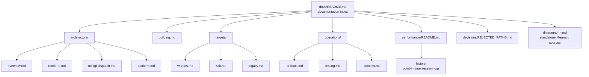
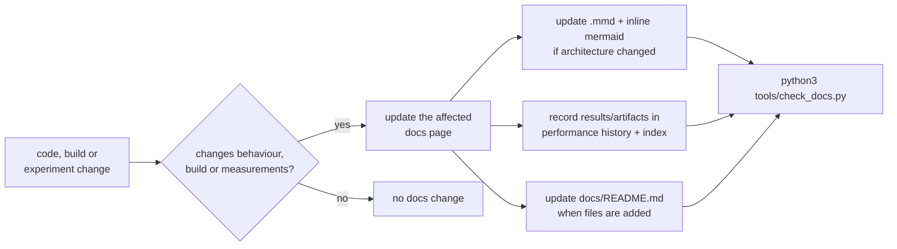

# BlitzQuake documentation

This directory is the canonical documentation for this tree: the 2002
BlitzQuake GLQuake/GLQuakeWorld source plus the 2026 Amiga port and
optimization work (68k MiniGL dispatch and WarpOS/PPC MiniGL R200).

Everything here is meant to be kept current. If you change code, a build or a
measured result, update the matching page in the same change — see
[Documentation maintenance](#documentation-maintenance) below.

## Start here

| I want to… | Read |
|---|---|
| Understand what runs where on the Amiga | [architecture/overview.md](architecture/overview.md) |
| Understand the renderer and its frame pipeline | [architecture/renderer.md](architecture/renderer.md) |
| Understand the MiniGL dispatch client / host stack | [architecture/minigl-dispatch.md](architecture/minigl-dispatch.md) |
| Understand sys, video, sound and network layers | [architecture/platform.md](architecture/platform.md) |
| Build for WarpOS/PPC | [building.md](building.md), [targets/warpos.md](targets/warpos.md) |
| Build for 68060 + MiniGL dispatch | [building.md](building.md), [targets/68k.md](targets/68k.md) |
| Build the original/legacy targets | [targets/legacy.md](targets/legacy.md) |
| Run a hardware session / deploy a build | [operations/runbook.md](operations/runbook.md) |
| Launch the game with the 68k front-end | [operations/launcher.md](operations/launcher.md) |
| Run tests and probes | [operations/testing.md](operations/testing.md) |
| Check the current performance state | [performance/README.md](performance/README.md) |
| Know which experiments are closed | [decisions/REJECTED_PATHS.md](decisions/REJECTED_PATHS.md) |
| Read the raw session logs | [performance/history/](performance/history/) |

## Documentation map

<!-- mmd: docs-map.mmd -->


## Repository at a glance

- `glquake/` — Quake/GLQuake client and dedicated server (the main tree).
- `glqwcl/` — QuakeWorld client and server (the second tree, mostly legacy
  2002-era code; see [targets/legacy.md](targets/legacy.md)).
- `tools/` — host-side tests, analyzers, release guards, and captured
  hardware evidence under `tools/evidence/`.
- `docs/` — this documentation.

Two build families are actively maintained in 2026:

1. **68060 + PiStorm MiniGL dispatch client** —
   `glquake/Makefile.GCCAmiga68k_MiniGLDispatch`.
2. **WarpOS/PPC (MPC7410) + MiniGL V19 R200** —
   `glquake/Makefile.GCCAmigaWOS_MGL_V19`.

All other Makefiles are the original 1998–2002 ports and are kept for
reference; see [targets/legacy.md](targets/legacy.md).

## Documentation maintenance

**Rule: documentation is part of "done".** Any change that alters behaviour,
the build, a runtime switch, or a measured result must update the matching
documentation page in the same change set. Do not leave docs to a follow-up.

<!-- mmd: docs-maintenance.mmd -->


What to update for a given change:

| Change | Update |
|---|---|
| Renderer path, frame ordering, cvar | [architecture/renderer.md](architecture/renderer.md) |
| MiniGL client/host protocol, upload path, DLL expectations | [architecture/minigl-dispatch.md](architecture/minigl-dispatch.md) |
| sys/video/sound/network behaviour | [architecture/platform.md](architecture/platform.md) |
| Makefile, toolchain, build flags, artifacts | [building.md](building.md) and the matching `targets/` page |
| WarpOS landmine discovered | [targets/warpos.md](targets/warpos.md) |
| 68k/assembly/header-generator change | [targets/68k.md](targets/68k.md) |
| Deployment/session/recovery procedure | [operations/runbook.md](operations/runbook.md) |
| New test, probe, or evidence artifact | [operations/testing.md](operations/testing.md) |
| Any benchmark, hitch or A/B result | [performance/README.md](performance/README.md) **and** a dated file in [performance/history/](performance/history/) |
| An experiment that was rejected, parked, or quarantined | [decisions/REJECTED_PATHS.md](decisions/REJECTED_PATHS.md) |
| New/renamed/removed doc | this index |

### Conventions

- **Mermaid diagrams live twice.** The canonical standalone source is
  `docs/diagrams/<name>.mmd`; the same diagram is embedded inline in the
  markdown page as a ` ```mermaid ` fence immediately preceded by an HTML
  comment `<!-- mmd: <name>.mmd -->`. Update both copies together.
- **Links are relative** to the file that contains them and must resolve;
  `python3 tools/check_docs.py` verifies this.
- **Paths that are not links** (inside code spans or tables) are written
  relative to the repository root unless stated otherwise.
- **Historical pages** in `performance/history/` are point-in-time records.
  Keep them readable but do not rewrite their measurements; add a short
  status banner instead if the outcome changed later.
- **Artifacts are identified by CRC32** (and sometimes size). Always record
  the CRC of the exact deployed file, plus the build command line.

### Documentation checks

```sh
# Validate all relative links and the .mmd <-> inline-mermaid contract.
python3 tools/check_docs.py
```

The checker is part of the local gate set in
[operations/testing.md](operations/testing.md).
