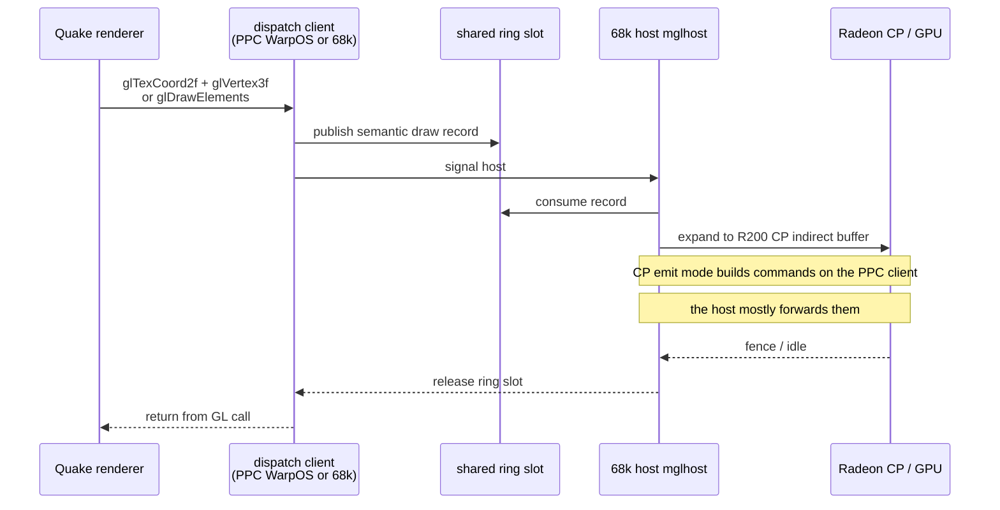
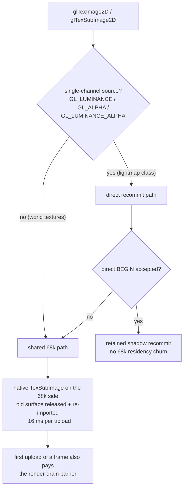

# MiniGL dispatch architecture

This page explains how GL calls from the Quake renderer reach the Radeon on
the maintained targets. The MiniGL implementation itself (client library,
`minigl_ppc.dll`, `mglhost`) lives **outside this repository** (MiniGL V19
tree and the PiStorm SDK); this repository only contains the Quake-side client
code and its expectations. Where behaviour is inferred from the external
sources, it is marked as such.

## Two dispatch flavours

| Target | Client library | Runtime model |
|---|---|---|
| 68060 + PiStorm | `libminigl_dispatch.a` (PiStorm SDK) | In-process dispatch to the `minigl.library` backend on the same CPU. |
| WarpOS/PPC | `libminigl.a` (MiniGL V19) | PPC client publishes records into a shared ring; the 68k `mglhost` process expands/submits them; `minigl_ppc.dll` implements the R200 frontend. |

The Quake-side API surface is identical: `glquake/miniglclient.h` includes the
dispatch table header (`proto/minigl.h`) and remaps
`mini_CurrentContext` to `(*MiniGLDispatch->currentContext)`, and
`MGLInit()`/`MGLTerm()` to `MiniGLOpen()`/`MiniGLClose()`.

## Round trip

<!-- mmd: minigl-dispatch-sequence.mmd -->

### CP emit

`MGLPPC_CPEMIT=1` (environment variable, volatile unless saved to `ENVARC:`)
moves command-packet construction from the 68k host to the PPC frontend. On
the measured stack this was the single largest win: Quake went from ~5 fps to
~12.2 fps at 800×600×32, and gears from 134 to 187 fps at 640×480×16. It also
changed *where* the bottleneck sits: after CP emit, the frame waits are
dominated by GPU retirement fences, not by the 68k host
(`CP_WAIT wait = fence` ≈ 95% of attributed wait at 800×600×32).

Consequences for optimization work:

- Batching client-side GL submission does **not** help under CP emit; the
  per-vertex frontend work is unchanged and staging costs extra. That is why
  the A1/A1b workstream was abandoned (see
  [REJECTED_PATHS.md](../decisions/REJECTED_PATHS.md)).
- The remaining lever on the 32-bit target is reducing **dispatches per
  frame** (fewer, larger batches at the semantic level) or changing fence
  semantics. The latter was attempted as W-80 and parked: the production
  stack does not survive back-to-back indirect dispatches without an
  intervening idle wait.
- Sound and networking work must not add per-frame WarpOS LP calls: each call
  is milliseconds and contends with `mglhost` on the same 68060.

### Waits and fences (observed)

- A client publish can wait for GPU retirement (`fence=`) or for host
  consumption (`host=`); the counters are split in the profiled DLL/host
  pair.
- Every dispatch carried a full-idle fence tail on the production chip, which
  serialises the GPU many times per frame; removing it (W-80) wedged or
  stalled the machine, hence the "parked" decision.
- Frame-260 measurements show the first lightmap upload of a frame also pays
  a render-drain barrier (see below).

## Texture upload paths

<!-- mmd: texture-upload-paths.mmd -->

Rules that came out of the frame-260 investigation:

- GLQuake never calls `glGenTextures`; texture names come from an arithmetic
  counter and lightmaps use `1024+i`. The host must bind the packet's name
  explicitly before a direct-BEGIN query, otherwise native code refuses every
  BEGIN because the name was never "generated".
- The direct class is restricted to single-channel formats because they are
  never mipmapped in this engine. World textures must stay on the shared path
  so their mip levels survive. Do not infer "no mips" from `generated` or the
  mirror filter — both are proven unreliable.
- Residency churn (~16 ms per upload, depth-independent) is the dominant
  upload cost, so per-frame upload count is the metric to reduce. Coalescing
  the four per-frame lightmap uploads remains an open optimization.

Full data: [history/FRAME260_INVESTIGATION.md](../performance/history/FRAME260_INVESTIGATION.md).

## FastPath (experimental, unused by default)

`mglBeginFastPath` / `mglFastPathTexCoord2f` / `mglFastPathVertex3f` /
`mglEndFastPath` are dispatched through a `MGLFastPath` structure
(`gl_rsurf.c` in the batching code). The dispatch-ABI addition is
append-only and compatible with ABI 3 (size check `0x238`), and all table
copies were synced except the classic tree, which has its own ABI v4/v5.
**The default renderer does not use FastPath.** Batch-level FastPath direct
writes measured −1.7%, and per-polygon FastPath in `mglTV23fv` measured
−3…−4%, so it stays off.

## Client lifecycle in this tree

Implemented in `glquake/gl_vidamiga.c`:

1. `MGLInit()` (= `MiniGLOpen()`) with a fatal `Sys_Error("MiniGLOpen
   failed")` on failure. On WarpOS the DLL is loaded via the Hyperion loader
   from the CWD by default; `MINIGL_PPC_DLLNAME` (set through
   `MGL_DLL_OVERRIDE` in the Makefile) can point at
   `Work:ibdraw/minigl_ppc.dll` instead. **A stale DLL in the game directory
   silently resurrects fixed defects** — verify the CRC after every copy.
2. Configuration: `mglChooseGuardBand`, `mglChooseVertexBufferSize(3000)`,
   `mglChooseMtexBufferSize(6000)`, `mglChoosePixelDepth`, `mglChooseWindowMode`,
   `mglChooseNumberOfBuffers`.
3. `mglCreateContext`, `mglEnableSync`, `mglLockMode`, `mglSetZOffset`.
4. Per frame: `mglLockDisplay` before rendering, `mglSwitchDisplay` (which
   also unlocks) to present.
5. Shutdown: `mglDeleteContext`, `MiniGLClose`; on WOS,
   `intuition.library`/`graphics.library` are closed too.

Known no-ops on the measured stack: `mglResizeContext` (mode changes need a
restart) and `glClientActiveTextureARB`.

## Frontend restrictions measured on this stack

These are the MiniGL R200 behaviours the client works around; the original
defect report is preserved in
[history/MiniGL_R200_BUG_REPORT.md](../performance/history/MiniGL_R200_BUG_REPORT.md).

| Area | Measured behaviour | Client-side handling |
|---|---|---|
| `glTexImage2D` internalformat | `GL_RGBA` and `GL_LUMINANCE` were rejected (MiniGL errors `0x59`/`0x58`); `GL_RGB` and `GL_RGB5_A1` work | Fonts upload with `GL_RGB5_A1`; lightmaps use a single-channel class routed through the direct path |
| `glTexImage2D` cost | ~101 ms fixed per call regardless of size on the early DLL (level load 20–30 s) | Load-time only; not fixable client-side |
| `glTexSubImage2D` cost | ~136 ms per 128×128, ~408 ms per 256×256 before the frame-260 fix | Static lightmaps only on old DLLs; direct recommit on fixed DLLs |
| `mglWriteShotPPM` | Silent no-op on the early DLL | Do not rely on engine screenshots; verify with the operator or host tools |
| Draw calls / vertex dispatch / `glClear` | Fast: 0.07–0.27 ms/quad, 25–75 µs/vertex-pair, 2–7 ms/clear | The frontend was never the problem; dispatch volume and fences are |
| `glGetError` codes | `0x58`/`0x59` are MiniGL-specific, not GL 1.1 enums | Drain errors via `GL_CheckErrors` in the dispatch build |

> The defect line was fixed on the MiniGL side in stages (deployed DLL CRCs
> in the history pages). Always check the deployed DLL CRC before assuming a
> workaround is still needed. Do not reintroduce workaround code that a
> newer DLL has made unnecessary without measuring.

## Related pages

- [renderer.md](renderer.md) — what is being submitted.
- [platform.md](platform.md) — sys/video glue around the client.
- [targets/warpos.md](../targets/warpos.md) — session protocol, DLL loading,
  MOS2WOS pitfalls.
- [performance/README.md](../performance/README.md) — measured state.
