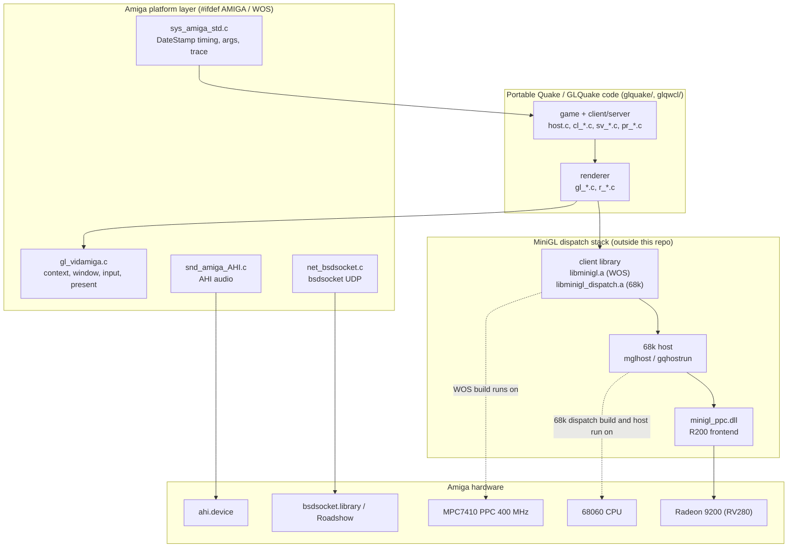

# Architecture overview

BlitzQuake is Christian Michael's 2002 Amiga port of GLQuake and GLQuakeWorld
(`BlitzQuake_src.readme`). The tree still contains the original multi-platform
source; the 2026 work in this repository targets two Amiga configurations:

1. **68060 (PiStorm-class) with the PiStorm SDK MiniGL dispatch client** —
   software side runs on the 68060, MiniGL is an external library.
2. **Amiga 4000 + MPC7410 WarpOS PPC card, Prometheus + Radeon 9200, MiniGL
   V19 R200** — game client runs as a PPC task, with a 68k host process
   (`mglhost`) servicing the MiniGL dispatch ring.

> When a task does not say which target it aims at, ask. "Amiga" alone is
> ambiguous between these two.

## Runtime components

<!-- mmd: system-overview.mmd -->


The engine is portable C; everything Amiga-specific is funnelled through the
platform layer. The renderer only ever calls the OpenGL-subset API exposed by
MiniGL (either through `mgl.library` in classic builds or through the dispatch
client libraries in the maintained targets). Details:

- [renderer.md](renderer.md) — frame pipeline, surface routing, cvars.
- [minigl-dispatch.md](minigl-dispatch.md) — how GL calls reach the Radeon.
- [platform.md](platform.md) — sys/video/sound/network layers.

## Source tree layout

```
BlitzQuake_src/
├── glquake/                    Quake + GLQuake client/server (main tree)
│   ├── *.c, *.h                portable engine + renderer
│   ├── *68k.s, *PPC.s          platform assembly (legacy builds only)
│   ├── genasmheaders.c         struct-offset header generator
│   ├── *.gen                   generator command files
│   ├── Makefile.GCCAmiga68k_MiniGLDispatch   maintained 68k dispatch build
│   ├── Makefile.GCCAmigaWOS_MGL_V19          maintained WarpOS build
│   ├── Makefile.GCCAmigaWOS_probe[_io]       MiniGL / I-O probe builds
│   ├── warpos_gcc_v19/         WOS build output + probe sources
│   ├── m68k_gcc_perf/          68k dispatch build output (gitignored)
│   └── README.MinGLDispatch.md 68k dispatch build notes
├── glqwcl/                     QuakeWorld client/server (legacy tree)
├── tools/                      host-side tests, analyzers, evidence
│   └── evidence/frame260/      captured hardware evidence
└── docs/                       this documentation
```

Generated/build artifacts are gitignored; see [building.md](../building.md)
for the artifact paths.

## Target families

| Family | Build file | Runs on | Graphics path |
|---|---|---|---|
| 68k MiniGL dispatch | `glquake/Makefile.GCCAmiga68k_MiniGLDispatch` | 68060 | PiStorm SDK `libminigl_dispatch.a` |
| WarpOS PPC | `glquake/Makefile.GCCAmigaWOS_MGL_V19` | MPC7410 (PPC) + 68k host | MiniGL V19 `libminigl.a` + `minigl_ppc.dll` |
| Linux | `glquake/Makefile.linuxi386` | x86 Linux | Mesa/X11, SVGA, 3dfx |
| Legacy Amiga 68k/PPC | `Makefile.Amiga68k*`, `Makefile.AmigaWOS*`, `Makefile.AmigaPUp`, `Makefile.MorphOS`, `Makefile.GCCAmiga*` | 68k / PowerUP / WarpOS / MorphOS | classic `mgl.library`, Warp3D |

See [building.md](../building.md) for exact commands and
[targets/legacy.md](../targets/legacy.md) for the legacy table.

## Platform constraints that shape the code

These apply to everything in `glquake/` and must survive refactoring:

- **Big-endian everywhere on Amiga.** 68k and PPC are both big-endian, so
  in-RAM structure layouts are endian-compatible between them, but **all
  external data** (PAK, BSP, MDL, SPR, WAV, network packets) is little-endian
  and must go through `LittleShort`/`LittleLong`/`BigShort`/`BigLong`. The
  function pointers are set once in `COM_Init` (`glquake/common.c:1160`).
  Never type-pun a wire/file struct directly.
- **Alignment.** 68060 requires natural alignment for word/long accesses;
  PPC requires it too. Keep asm-visible structures naturally aligned, and never
  assume the packed 68k ABI on PPC (see
  [targets/warpos.md](../targets/warpos.md#the-packed-struct-abi-trap)).
- **Memory is split** into chip/slow/fast pools, and WarpOS PPC RAM is
  separate. The renderer allocates map-lifetime data from the Quake hunk (one
  allocation per map), not per frame. Avoid per-frame heap churn; buffers are
  preallocated. The `-mem` launch option caps the hunk.
- **Single core, low clocks.** The 68060 host also services all OS calls from
  the PPC side (each WarpOS LP call costs on the order of milliseconds). One
  `DateStamp` per frame is cached precisely to avoid extra gateway calls.
- **Assembly depends on structure offsets.** Files such as
  `r_alias68k.s`, `mathlib68k.s`, `snd_mixamigaPPC.s` include generated
  offset headers (`quakedef68k.i`, `quakedefPPC.i`, …). If you change a
  structure consumed by assembly, regenerate the headers for **every affected
  target**; see [building.md](../building.md#assembly-offset-headers).
- **WarpOS shutdown/restart hazards.** A crashed PPC client ghosts the MiniGL
  host; recover with a reboot. See
  [operations/runbook.md](../operations/runbook.md).

## Startup sequence (WarpOS target)

1. `C:InitPPC` exactly once per boot.
2. Start the 68k MiniGL host (`Work:ibdraw/gqhostrun`), verify the host port.
3. Launch `glquakeWOS` from the directory containing `minigl_ppc.dll`.
4. `main()` (`glquake/host.c`) → `Host_Init` → game init; `VID_Init` opens
   `intuition.library`/`graphics.library`, `MGLInit()` loads
   `minigl_ppc.dll`, then `mglCreateContext`.
5. Frame loop: input → `SV_/CL_` game update → `SCR_UpdateScreen` →
   `R_RenderView` → HUD/2D → `mglSwitchDisplay`.
6. Quit from the game menu or the window close gadget. A clean
   `MiniGLClose` lets the host exit; anything else requires a reboot.

The 68k dispatch target follows the same game flow but opens
`minigl.library` in-process through the PiStorm SDK dispatch client.

## Further reading

- [../building.md](../building.md) — all build commands and validation gates.
- [../operations/runbook.md](../operations/runbook.md) — hardware session
  protocol and deployment.
- [../performance/README.md](../performance/README.md) — what is fast, what is
  not, and how it is measured.
- [../decisions/REJECTED_PATHS.md](../decisions/REJECTED_PATHS.md) — do not
  retry these.
