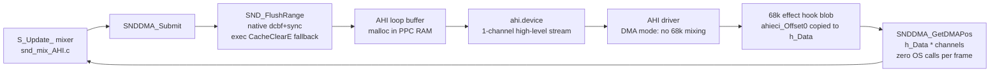
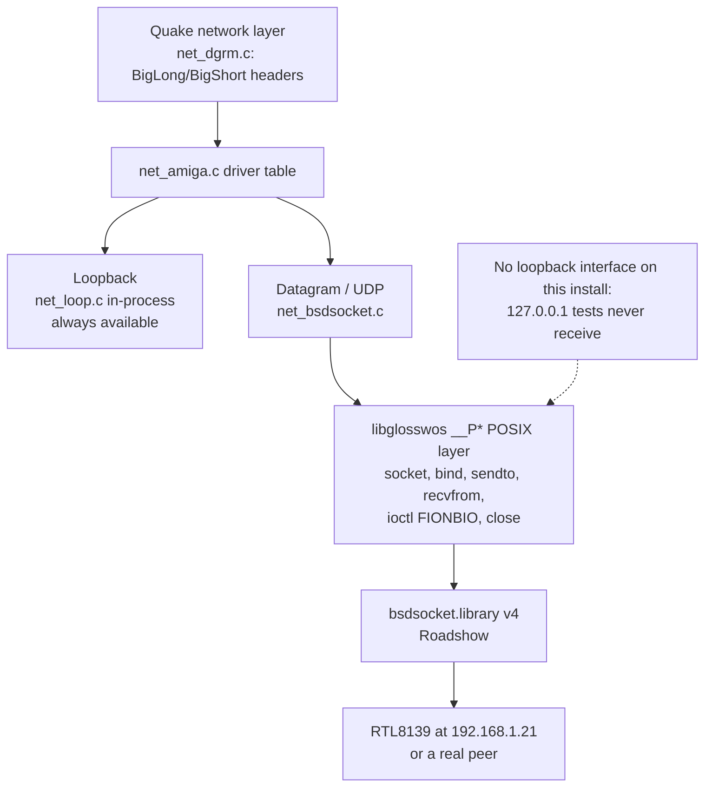

# Amiga platform layer

Everything platform-specific funnels through a small set of files. This page
documents the maintained behaviour, with the WarpOS landmines that cost the
most time. Toolchain and ABI details are in
[targets/warpos.md](../targets/warpos.md); this page is the runtime map.

## File map

| Area | File | Notes |
|---|---|---|
| System/timing (current) | `glquake/sys_amiga_std.c` | WOS-aware: `WOS_EClockTime`, `WOS_FrameClockTick`, `Sys_WOSTrace`, `-clpri`, `FP_*` hooks. |
| System/timing (legacy) | `glquake/sys_amiga.c` | 2002 M68k/PowerUP layer; `GetSysTimePPC` unconditionally. Not built by maintained targets. |
| Video/GL context | `glquake/gl_vidamiga.c` | MiniGL context, window, IDCMP input, present, menus. |
| Input dispatch | `glquake/in_amiga.c` + `in_amigamouse.c`, `in_amigajoy.c`, `in_amigapsx.c` | Mouse/joy/PSX drivers fanned into `usercmd_t`. |
| Sound | `glquake/snd_amiga_AHI.c`, `snd_mix_AHI.c`, `wos_ahi_abi.h` | 68k `audio.device` and AHI; WOS high-level AHI. |
| Networking | `glquake/net_amiga.c`, `net_bsdsocket.c` | Driver table + bsdsocket UDP. |
| Trace | `glquake/wos_stalltrace.h` | `WOS_STALL`/`Sys_WOSTrace` macros, no-ops off-WOS. |
| Compiler glue | `glquake/amigacompiler.h` | `SAVEDS`/`ASM`/`REG()` per compiler. |
| Clipboard | `glquake/sys_amigaclip.{c,h}` | DOS clipboard helper. |

`dosisms.h` is **not** Amiga code (DOS/x86 real-mode helpers for the
Linux build); do not cite it as Amiga platform support.

## System and timing

- One `DateStamp()` per host frame is cached in `WOS_FrameClockTick()`. All
  intra-frame `Sys_FloatTime()` callers reuse it. Rationale: each WarpOS
  LP call goes through a 68k gateway and costs milliseconds on this stack;
  the old sound path issued two per frame (~30 ms/frame).
- `WOS_EClockTime()` converts DateStamp days/minutes/ticks to seconds in
  `double` (the naive `days*86400*50` overflows 32-bit long on PPC).
  Resolution is 1/50 s.
- `usleep()` is wrappered to `Delay()` on WOS. `Delay(1)` replaces
  `usleep(1)` at startup because libglosswos' sleep path crashes with
  `PowerPCBase == NULL`.
- `TimerBase` is `struct Library *` on WOS (exactly that type), and
  `PowerPCBase` is defined but left `NULL`. Never open `ppc.library` from a
  PPC task and never call `GetSysTimePPC`/`SubTimePPC`; timing goes through
  dos `DateStamp`.
- `-clpri N` raises the client task priority (default 5, `0` disables) so
  exec/dos gateway calls stay responsive while the 68k side is saturated
  draining the dispatch ring.
- `Sys_WOSTrace(tag)` appends one line to `RAM:gqtrace` using direct
  DOS open/write/close — independent of stdio, which may be broken when
  `PowerPCBase` paths are involved. The last marker names the crash site.
  `Sys_WOSTraceFrame` adds `f<N> <tag> <secs>` markers for the first frames.
- `FP_Init`/`FP_AutoDump` (frame profiler) are invoked from
  `sys_amiga_std.c`; see [renderer.md](renderer.md#frame-profiler).

## Video and input

`gl_vidamiga.c` is MiniGL-only: it never opens an Intuition screen directly.

- `VID_Init` opens `intuition.library` v37 and `graphics.library` v37 on WOS
  (the old PowerUP toolchain auto-opened bases; MOS2WOS does not). Both are
  closed in `VID_Shutdown` after `mglDeleteContext()`.
- Options: `-width`, `-height`, `-bpp` (15–32, default 32), `-buf`
  (default 3; `2` forces video sync on), `-windowmode`, `-closewb`.
- Context setup: `mglChoosePixelDepth`, `mglChooseWindowMode`,
  `mglChooseNumberOfBuffers`, `mglCreateContext`, `mglEnableSync`,
  `mglLockMode`, `mglSetZOffset`.
- Present path: `GL_BeginRendering` + `mglLockDisplay` → draw →
  `GL_EndRendering` + `mglSwitchDisplay` (unlock included).
- `gl_width` triggers `mglResizeContext` in `GL_EndRendering`; on the measured
  stack `mglResizeContext` is a no-op, so a real mode change needs a restart.
- Input: `VID_ConfigureInputWindow` replaces the window's IDCMP mask with
  `RAWKEY|MOUSEBUTTONS|MOUSEMOVE|DELTAMOVE` (Q3 parity; fetched via
  `mglGetWindowHandle()` only) and sets `WFLG_REPORTMOUSE` so MOUSEMOVE
  events arrive; it does not call `ActivateWindow()`.
  `Sys_SendKeyEvents` drains `QuakeWindow->UserPort` and maps raw keys
  through `rawkeyconv`. On WarpOS/PPC the OS structs behind this path must
  be compiled with the real Amiga 2-byte alignment — the GCC build ignores
  the SAS/C `#pragma amiga-align`, which shifted `IDCMPFlags`/`UserPort`
  reads by +2 bytes and killed all input; see the input-pack fix in
  [targets/warpos.md](../targets/warpos.md#the-blitzquake-input-pack-fix-2026-09-22-keyboard--mouse-on-wos).
  `NOMOUSEASM` (enabled in both maintained builds) reads `MOUSEMOVE`/
  `DELTAMOVE` deltas into `m_move[]`, so drift comes straight from
  Intuition messages. `IN_MouseMove` gates on
  `IntuitionBase->ActiveWindow == QuakeWindow` — again only correct with the
  packed ABI (fixed 2026-09-22 in `in_amigamouse.c`).
- Pointer: `VID_ConfigureInputWindow` also calls `mglSetPointer()` (MiniGL's
  blank sprite) so the Amiga pointer does not sit over the game; `-showpointer`
  keeps it for windowed debugging. The `-windowmode` path is unaffected.
- Gamma: `Check_Gamma` defaults Voodoo/3Dfx-class hardware to 1.0, otherwise
  0.7; `-gamma` overrides. The known "gamma off on Amiga" issue lives here.
- There is **no ASL ScreenModeRequester** in the GL path. The software
  renderer has one in `vid_cppcstatic.c`; porting it to `VID_Init` is an open
  user request.

## Sound

Two implementations exist; the WOS target uses the high-level AHI path.

<!-- mmd: sound-wos.mmd -->

- **68k `audio.device` path** (`snd_amiga.c`, `snd_amiga_AHI.c` non-WOS
  branch): level-7 audio interrupt, chip DMA buffer. Never used on WarpOS —
  the 68k interrupt handler trips "powerpc.library: Async Run68K function not
  supported".
- **WOS high-level AHI path**: a 1:1 port of Quake 2's
  `quake3amiga/code/amiga/amiga_snd.c` scheme. `AHI_AllocAudio` with one
  channel, `AHI_LoadSound` dynamic sample, `AHIC_Play`, and the
  `AHIET_CHANNELINFO` effect hook. A static 68k code blob copies
  `ahieci_Offset[0]` into `hook->h_Data`, so `SNDDMA_GetDMAPos()` is a memory
  read — zero OS calls per frame.
- **Packed ABI is mandatory**: `wos_ahi_abi.h` provides `wos_AHIRequest`
  etc. with compile-time size guards, because MOS2WOS headers use natural PPC
  alignment while 68k AHI expects packed layout. Using the native struct
  wedges the machine on `SendIO`/`WaitIO`. See
  [targets/warpos.md](../targets/warpos.md#the-packed-struct-abi-trap).
- **Flush of the painted range is required before submit**: the 68060 does not
  snoop the PPC data cache and the AHI driver (68k) reads the buffer. The
  default is a native `dcbf`+`sync` over the exact range (`-sndflush native`);
  `-sndflush exec` restores the old `CacheClearE` LP call. The ring-size mask
  must use the real ring size (`wos_buflen`), not `AHIBUFFERSIZE`; the old
  256 KB mask is why the first native attempt went silent after ~1.5 s.
- **Choose an AHI DMA mode** (e.g. `Paula:DMA 8 bit stereo`) for full speed.
  Measured (640×480×16, demo1, 2026-09-22): CPU-mixing Paula modes cost
  ~4-5 ms/frame (the driver shares the 68060 with mglhost) and scale with the
  mix rate; the DMA mode costs ~0.1 ms. `-ahiid <hex>` overrides the mode for
  one run; the client prints a note for non-DMA modes.
- Measured sound cost is now ~0 ms/frame over `-nosound` (54.9-55.4 vs
  55.3 fps). `-audspeed N` sets the mix rate; `_snd_mixahead 0.3` helps at low
  frame rates. `-nosound` disables everything. Do not benchmark with
  `-condebug` (log I/O costs ~4 fps).
- Failure policy on WOS is silent degradation rather than `Sys_Error`.

## Networking

<!-- mmd: network-stack.mmd -->

- `net_amiga.c` registers the Loopback and Datagram drivers plus one LAN
  driver (`bsdsocket.library TCP/IP`) that maps to `UDP_*` in
  `net_bsdsocket.c`.
- The WOS branch uses **only** the libglosswos `__P*` layer: `socket()`,
  `bind()`, `sendto()`, `recvfrom()`, `ioctl(FIONBIO)`, `close()`. Never mix
  it with the raw Amiga-named entry points (`CloseSocket`, `IoctlSocket`,
  `Inet_NtoA`, `SocketBaseTagList`) — fd values are libglosswos table indices,
  not raw bsdsocket handles, and mixing layers returns −1 everywhere.
- `SocketBase` is owned by libglosswos and must **not** be closed at
  shutdown; its `.fini` destructor handles it.
- **errno numbering differs**: the stack writes AmiTCP/Roadshow numbers
  through `SBTC_ERRNOLONGPTR`, while newlib's `<errno.h>` in this SDK uses
  different values (`ECONNREFUSED` 61 stack vs 111 newlib). Use the explicit
  `NET_EWOULDBLOCK`/`NET_ECONNREFUSED` constants in `net_bsdsocket.c`.
- **Wire byte order**: every Quake network header goes through
  `BigLong`/`BigShort` (`net_dgrm.c`), which are no-ops on big-endian Amiga
  but mandatory for correctness on other hosts. The swap function pointers
  are set once in `COM_Init` (`common.c`).
- On the measured Roadshow install there is no loopback interface, so
  127.0.0.1 tests never receive; test against the machine's own address or a
  real peer. Options: `-noudp` disables UDP; `-udpport` and `-ip` configure
  it; a hostname is required.

## Platform support headers

- `wos_ahi_abi.h` — packed 68k-struct mirrors for AHI (`wos_Message`,
  `wos_IORequest`, `wos_IOStdReq`, `wos_AHIRequest`, `wos_Library`) with
  static size guards. Use these for **any** struct passed by pointer to 68k
  code.
- `wos_stalltrace.h` — `WOS_STALL` macro and `Sys_WOSTrace` declaration;
  compiles to no-ops off WOS.
- `amigacompiler.h` — calling-convention macros shared by the 2002 sources.

## Rules for platform-layer edits

1. Never add a WarpOS LP call to a per-frame path. Cache once per frame if
   absolutely necessary (`WOS_FrameClockTick` is the model).
2. Never pass a native MOS2WOS struct by pointer to 68k device/library code;
   use or add a packed mirror.
3. Any buffer written by PPC and read by 68k (sound, DMA, shared structs)
   needs an explicit cache flush; `CacheClearE` is the proven tool.
4. Close what you open, in reverse order; do not close libglosswos-owned
   bases.
5. Keep `-nosound`/`-noudp` as clean fallbacks — they are the recovery path
   for hardware sessions.
