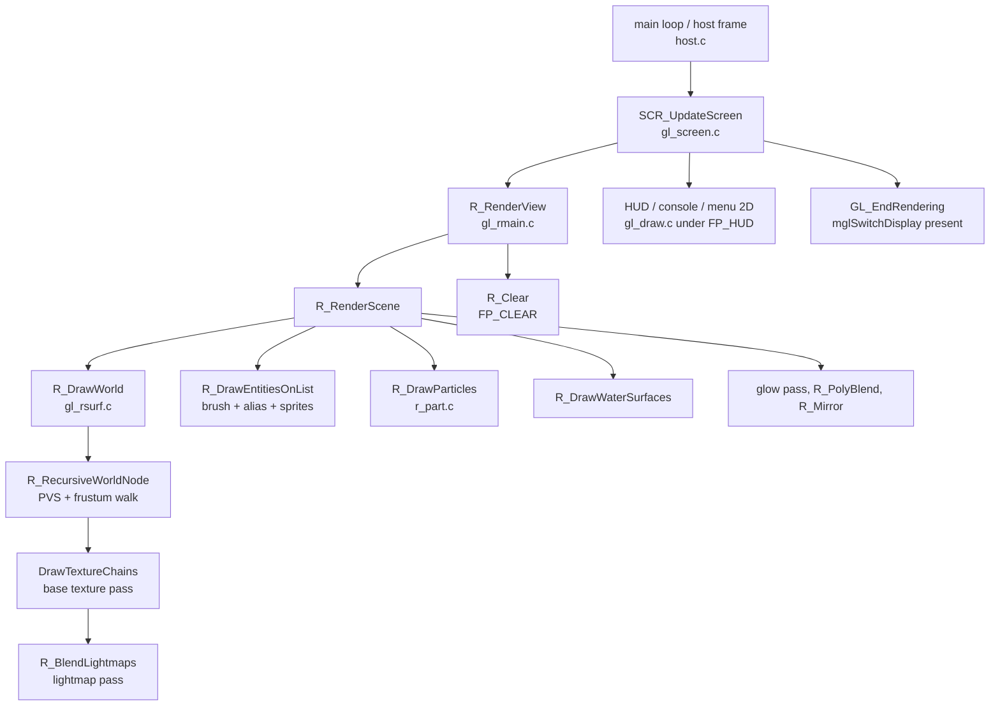
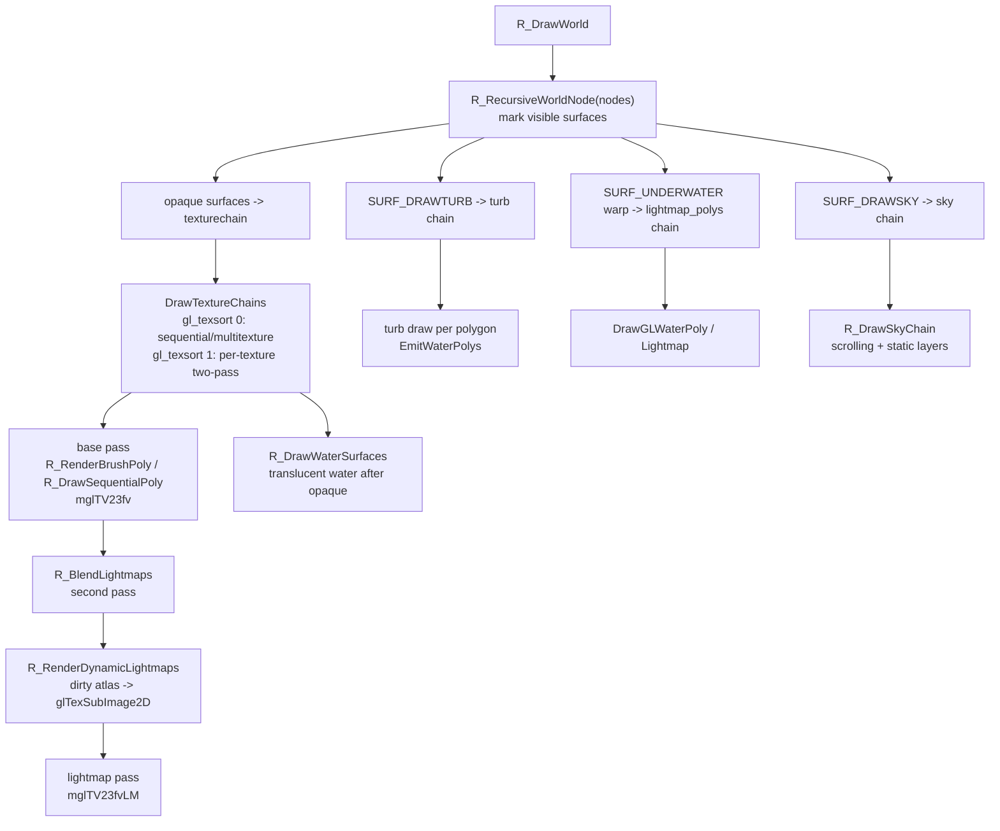

# Renderer architecture

The renderer is the original GLQuake renderer (`glquake/gl_*.c`, `r_*.c`,
`d_*.c`) with a MiniGL-oriented Amiga backend. This page describes what the
frame does and where each surface type is drawn. For the transport to the GPU,
read [minigl-dispatch.md](minigl-dispatch.md) next.

## Compile-time renderer variants

Two orthogonal switches matter:

| Switch | Classic value | Dispatch value | Effect |
|---|---|---|---|
| `MINIGL_DISPATCH_CLIENT` | undefined | defined by both maintained builds | Targets `minigl.library`/MiniGL V19 through a dispatch client instead of classic `mgl.library`; selects `gl_lightmap_format = GL_LUMINANCE`, error drains, alpha-fill texture path, etc. |
| `WOS` | undefined | WOS build | WarpOS PPC platform paths: packed AHI ABI, `DateStamp` timing, frame profiler, stall trace. |

The classically-built Amiga targets (`Makefile.Amiga68k*`,
`Makefile.AmigaWOS*`, PowerUP, MorphOS) use `mgl.library` and its direct
vertex-buffer API (`mglTV23fv`, see `glquake/miniglext.c`). The dispatch
targets emulate those helpers with ordinary GL calls:
`glMultiTexCoord2fARB`/`glTexCoord2f` + `glVertex3f` loops, and
`glDrawElements` batch paths where the API supports them.

Other feature gates seen in the renderer:

- `GLQUAKE` — GL vs software rendering.
- `LITFILES`, `GLOWEFFECTS`, `FASTBOPS`, `VERTEXARRAYS`, `TRIGTABLES` — 2002
  eyecandy/optimization features enabled by the maintained Makefiles.
- `gl_texsort` — runtime choice of texture-sorted two-pass (1) or
  sequential/multitexture (0) world rendering; see below.
- `r_dynamic` — runtime gate for dynamic lightmap updates.

## Frame pipeline

<!-- mmd: frame-pipeline.mmd -->


Ordering that must not be broken (translucency, lightmap rebuilds, mirror,
blend state) is described in [draw order rules](#draw-order-rules).

## World geometry

### Data structures

- `glpoly_t` (`gl_model.h`) — one convex polygon:
  `next, chain, numverts, flags, verts[][VERTEXSIZE]` with `VERTEXSIZE 7`.
  Each vertex is `x, y, z, s1, t1, s2, t2`:
  - slots 0–2: position
  - slots 3–4: base texture UV
  - slots 5–6: lightmap UV (or warped second UV for water)
  This is exactly the layout the MiniGL `mglTV23fv` / `mglTV23fvLM` helpers
  consume in the classic build.
- `msurface_t` (`gl_model.h`) — `visframe`, plane, `SURF_*` flags,
  edge range, texture extents, `light_s/light_t`, `polys`, `texturechain`,
  `texinfo`, dynamic-light state, `lightmaptexturenum`, light styles.
- `texture_t` (`gl_model.h`) — name, dimensions, `gl_texturenum`, and the
  `texturechain` used by the sorted renderer.
- Lightmap atlas state (`gl_rsurf.c`): 128×128 `BLOCK_WIDTH/HEIGHT`,
  `MAX_LIGHTMAPS 64` atlases, allocation bitmap `allocated[64][128]`,
  `lightmaps[]` backing store, `lightmap_polys[64]` chain heads,
  `lightmap_modified[64]`, and a `glRect_t` dirty rect per atlas.

`BuildSurfaceDisplayList()` runs once per map surface from
`GL_BuildLightmaps()` and produces the final polygons (subdivision and
collinear-vertex removal included). Batch experiments copy out of these
polygons; they never modify them.

### Surface routing

<!-- mmd: world-render-flow.mmd -->


Key entry points:

| Function | File | Role |
|---|---|---|
| `R_DrawWorld` | `gl_rsurf.c` | Per-frame world entry; marks surfaces, runs chains and lightmap blend. |
| `R_RecursiveWorldNode` | `gl_rsurf.c` | BSP/PVS frustum walk; chains visible surfaces, does not draw. |
| `DrawTextureChains` | `gl_rsurf.c` | Sorted renderer: per-texture loop over sky/mirror/turb/opaque chains. |
| `R_RenderBrushPoly` | `gl_rsurf.c` | Opaque two-pass surface draw (base pass). |
| `R_DrawSequentialPoly` | `gl_rsurf.c` | `gl_texsort 0` immediate/multitexture surface draw. |
| `R_BlendLightmaps` | `gl_rsurf.c` | Second pass over `lightmap_polys` atlases. |
| `R_BuildLightMap` / `R_BuildLightMapColor` | `gl_rsurf.c` | CPU lightmap computation into `blocklights`. |
| `R_RenderDynamicLightmaps` | `gl_rsurf.c` | Uploads dirty atlas rectangles (`glTexSubImage2D`). |
| `EmitWaterPolys` | `gl_warp.c` | Turbulent `SURF_DRAWTURB` polygon submission. |
| `DrawGLWaterPoly[Lightmap]` | `gl_rsurf.c` | `SURF_UNDERWATER` warped draw (with `r_dowarp`). |
| `EmitSkyPolys` / `EmitBothSkyLayers` / `R_DrawSkyChain` | `gl_warp.c`, `gl_rsurf.c` | Scrolling sky layers and skybox. |
| `R_DrawBrushModel` | `gl_rsurf.c` | Inline brush entities (doors, plats, …), separate path. |
| `R_DrawAliasModel` | `gl_rmain.c` | MDL models, vertex-array and immediate variants. |
| `R_DrawSpriteModel` | `gl_rmain.c` | SPR sprites. |
| `R_DrawParticles` | `r_part.c` | Point/quad particles. |

### Texture-sorted vs sequential

- `gl_texsort 1` (default; `R_Init` forces it to `0` when real multitexture is
  available): opaque surfaces are collected per texture during traversal, then
  drawn texture by texture (base pass), followed by a lightmap pass per atlas.
  This is the path the A1 batch experiment targeted.
- `gl_texsort 0`: each visible surface is submitted immediately
  (`R_DrawSequentialPoly`), optionally with real multitexture.
- `gl_fake_multitexture` selects the old `mglMtexTV23fv` two-UV emulation;
  the dispatch build defaults it to `0` and the world-batch code refuses to
  run with any non-zero fake value.

### Draw order rules

Violating these produces visible artifacts that are hard to debug:

1. Opaque world base pass before lightmap pass; dynamic atlas updates happen
   just before the atlas is used.
2. Turbulent water is opaque for the sorted path and translucent water is
   drawn in `R_DrawWaterSurfaces` after opaque geometry.
3. Mirrors (`R_MirrorChain`) and glow passes keep their relative order.
4. 2D/HUD is drawn after the world and entities, with blend/scissor state
   boundaries preserved (see `Draw_AlphaFill`, `R_PolyBlend`).

## Lightmaps and the frame-260 lesson

Dynamic lightmaps are the single most watched cost in this port. The
measured chain is:

1. A dynamic light touches surfaces → `R_BuildLightMap` computes pixels into
   `blocklights` (CPU cost ~0.13 ms per frame in the captures).
2. `R_RenderDynamicLightmaps` uploads dirty rectangles per atlas.
3. On the R200 stack those uploads originally cost ~16–17 ms each because the
   native path released and re-imported texture residency every time, and a
   frame could issue four uploads at one hitch.

The frame-260 fix routes **single-channel (lightmap-class) uploads** through a
direct recommit path with a retained shadow copy; world textures stay on the
shared 68k path so mip levels survive. See
[history/FRAME260_INVESTIGATION.md](../performance/history/FRAME260_INVESTIGATION.md)
and [minigl-dispatch.md](minigl-dispatch.md#texture-upload-paths).

When touching lightmap code:

- Do not add per-frame allocations; atlases and dirty rects are fixed-size.
- Keep the `glRect_t` dirty-rect aggregation intact; coalescing uploads per
  frame is a known, still-open optimization.
- `FP_LMBUILD` / `FP_LMUPLOAD` profiler sections must stay around the build
  and upload sites.

## Particles, models, 2D

- **Particles** (`r_part.c`): `R_DrawParticles` integrates particle motion on
  the CPU and draws either hardware points (`r_particle_size 1`, one TCL
  vertex per particle) or screen-space quads (`0` = automatic size,
  `>1.5` = forced quad size). The 256-particle limit remains a safety bound.
- **Alias models** (`gl_rmain.c`): immediate frame draw, array frame draw,
  interpolated draw, shadow draw; `r_vertexarrays`/`r_interpolations` select
  paths. Models are endian-swapped at load (`gl_model.c`).
- **2D** (`gl_draw.c`): glyphs, console background, pictures, status bar,
  fade and alpha fills. On the dispatch build `Draw_AlphaFill` uses a
  16-entry 1×1 alpha-step texture cache; `GL_Set2D` forces `GL_REPLACE`.

## Frame profiler

`glquake/frame_profile.{c,h}` is a WarpOS-PPC-only nested section timer
(no-op elsewhere). It is opt-in at runtime:

```text
-frameprofile [path]      dump to path (default DH2:wosbuild/frameprof.txt)
-framewindow first last   retain an explicit frame window
```

Sections: `FP_SCREEN`, `FP_VIEW`, `FP_SCENE`, `FP_WORLD`, `FP_VIS`,
`FP_CHAINS`, `FP_LMBLEND`, `FP_LMBUILD`, `FP_LMUPLOAD`, `FP_ENTBRUSH`,
`FP_ENTALIAS`, `FP_PARTICLES`, `FP_WATER`, `FP_MIRROR`, `FP_GLOW`,
`FP_CLEAR`, `FP_BLEND`, `FP_HUD`, `FP_PRESENT`. Nesting overlaps by
construction — never sum across levels.

`FP_AutoDump()` writes the report after the timed interval (called from
timedemo end and cleanup). Analyze on the host with
`python3 tools/analyze_frame_profile.py <dump>`. See
[operations/testing.md](../operations/testing.md#frame-profiler-tools) for
tests and parsing caveats.

## Runtime controls (cvars)

Values below are the defaults in the maintained dispatch builds unless noted.
Use `+cvar value` on the command line or `autoexec.cfg`.

| Cvar | Default | Meaning |
|---|---|---|
| `gl_texsort` | `1` | 1 = texture-sorted two-pass world; 0 = sequential/multitexture. |
| `gl_fake_multitexture` | `0` dispatch / `1` classic | Two-UV emulation of multitexture. |
| `r_dynamic` | `1` | Dynamic lightmap updates. |
| `r_worldbatch` | `0` | Experimental A1/A1b world batching; **closed** — see below. |
| `r_particle_size` | `1` | 1 = hardware points; 0 = auto quad size; >1.5 = forced quad size. |
| `r_vertexarrays` | `1` | Alias-model client arrays where enabled. |
| `r_interpolations` | `1` | Interpolated alias frames. |
| `r_cullworld`, `r_cull_aggressive`, `r_model_maxdist`, `r_elim_areasize` | see `R_Init` | 2002 culling controls. |
| `r_skybox_format`, `r_litfiles`, `r_flames`, `r_particle_hack` | see `R_Init` | Eyecandy controls. |
| `gl_ztrick`, `gl_width`, `gl_videosync`, `gl_triplebuffer`, `gl_lightmapformat`, `gl_lockmode`, `gl_dithering`, `gl_polyoffset`, `gl_warp` | see `VID_Init` | Video/rendering controls (`gl_vidamiga.c`). |
| `-lm_LUMINANCE`, `-lm_ALPHA`, `-lm_RGBA`, `-lm_RGB` | `GL_LUMINANCE` on dispatch | Lightmap upload format override. |

`r_2dbatch` and `r_particlebatch` are **planned only**; no code exists.
Do not document them as available.

## Batching experiment status (closed)

`r_worldbatch` (A1 indexed world batches, A1b water/underwater staging,
FastPath submission) was implemented and then hardware-falsified on the
physical A4000/MPC7410+RV280 stack: every variant was neutral to −5% versus
the immediate renderer, because client→DLL dispatch is cheap while the
frontend's per-vertex cost is identical for every submission route. The
verdict and the required A/B protocol are recorded in
[history/WORKSTREAM_A_RENDERER_PLAN.md](../performance/history/WORKSTREAM_A_RENDERER_PLAN.md);
the decision is tracked in [REJECTED_PATHS.md](../decisions/REJECTED_PATHS.md).
The code remains in the tree behind `r_worldbatch 0` and must not be enabled
without a new MiniGL submission entry point.

## Memory and performance rules for renderer edits

- Map-lifetime data belongs in the Quake hunk (`Hunk_Alloc`), sized once from
  map content; no per-frame `malloc`.
- Do not write into persistent vertices that an array cache may retain
  (client-array contents must be stable while pointer/format state holds).
- Batch/draw counts, failures and RHW clamps are the parity metrics for any
  renderer change; the profiler dump reports them.
- A renderer change is only kept with a three-run physical-hardware median
  that beats the current baseline and preserves screenshots/geometry counters.
  A gain below 2% is treated as noise.
- Regenerate asm offset headers when touching structs used by `*.s` files
  (see [building.md](../building.md#assembly-offset-headers)).
