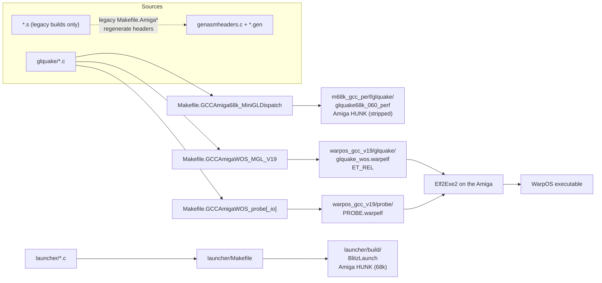
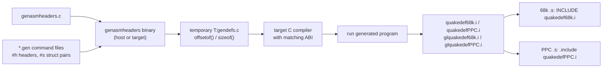

# Building

All 2026 builds are **cross-builds from Linux**. Only the WarpOS `.warpelf`
needs an on-Amiga step (`Elf2Exe2`). The 68k dispatch target produces an Amiga
HUNK executable directly.

<!-- mmd: build-matrix.mmd -->


## Maintained builds

### 68060 + PiStorm MiniGL dispatch

```sh
cd glquake
make -f Makefile.GCCAmiga68k_MiniGLDispatch
```

Output: `m68k_gcc_perf/glquake/glquake68k_060_perf` in Amiga HUNK format.

Requirements (checked by the `check-tools` target):

- `m68k-amigaos-gcc` with the Amiga NDK (`/opt/amiga/bin/m68k-amigaos-` by
  default).
- `vasmm68k_mot` with HUNK output.
- PiStorm SDK (`PISTORM_SDK`, default `/home/mirek/PiStorm_SDK_v10`) with
  `include/proto/minigl.h` and `lib/libminigl_dispatch.a`.
- AHI SDK headers (`devices/ahi.h`).

Key flags: `-m68060 -O3 -ffast-math -fomit-frame-pointer -DOPTIMIZE_060`,
`-DMINIGL_DISPATCH_CLIENT -DMINIGL_PERF_DIAGNOSTICS -DCOMMON68KASM`.

Run it with a large stack; see
[`glquake/README.MinGLDispatch.md`](../glquake/README.MinGLDispatch.md) for
the target-specific notes and
[operations/runbook.md](operations/runbook.md) for deployment.

### WarpOS/PPC + MiniGL V19 R200

```sh
cd glquake
make -f Makefile.GCCAmigaWOS_MGL_V19 \
  MGL_DIR=/home/mirek/MiniGL_WOS_V19_mglQ3
```

Output: `warpos_gcc_v19/glquake/glquake_wos.warpelf` (ET_REL). Convert on the
Amiga:

```text
Stack 100000
Elf2Exe2 glquake_wos.warpelf glquakeWOS
```

Requirements (checked by `check-tools`):

- `ppc-amigaos-gcc` (GCC 8.4.0 adtools is the validated one).
- The MOS2WOS WarpOS SDK overlay; the shared config is included from
  `$(MGL_DIR)/Makefile.wos.gcc.common` (`WOS_ARCH_CFLAGS`, `WOS_CPPFLAGS`,
  ET_REL link contract, `WOS_VALIDATE_ETREL`).
- MiniGL V19 tree with `include/proto/minigl.h` and `lib/libminigl.a`.

Overridable variables:

| Variable | Default | Purpose |
|---|---|---|
| `MGL_DIR` | `/home/mirek/MiniGL_WOS_V19_mglQ3` | MiniGL headers/archive and shared WOS makefile. |
| `CPU` | `604e` | Target CPU for the arch flags. |
| `DIAGNOSTICS` | `0` | `1` compiles in `WOS_DIAGNOSTICS` trace strings. |
| `MGL_DLL_OVERRIDE` | `Work:ibdraw/minigl_ppc.dll` | Baked `MINIGL_PPC_DLLNAME` path; prevents a stale game-dir DLL from shadowing the authoritative one. |
| `ARCH` | `warpos_gcc_v19/glquake` | Output directory. Useful to isolate experiment builds (a stale `minigl_ppc_open.o` once silently baked an old DLL path — always use a fresh `ARCH` for A/B builds). |

> `-fno-jump-tables` is mandatory (ET_REL relocation contract) and comes from
> `WOS_ARCH_CFLAGS`.

### Probe builds

```sh
cd glquake
make -f Makefile.GCCAmigaWOS_probe PROBE=qpresent      # MiniGL probes
make -f Makefile.GCCAmigaWOS_probe_io PROBE=wos_ahi    # no-GL I/O probes
```

Outputs under `warpos_gcc_v19/probe/`. See
[operations/testing.md](operations/testing.md#probes) for the probe catalogue.

### BlitzQuakePPC MiniGL Launcher (68k)

The 68k front-end for the WarpOS MiniGL client lives in its own top-level
directory:

```sh
cd launcher
make                 # build/BlitzLaunch, Amiga HUNK executable
make test            # build/argdump + build/cfgtest, on-target smoke tests
```

Requirements: the same `m68k-amigaos-gcc` + NDK as the 68k dispatch build
(`CROSS_PREFIX`, `NDK` overridable). It is plain 68k
(`-m68060 -noixemul`), opens intuition/graphics/gadtools/asl itself and never
links the game or MiniGL. Client, host, DLL and `id1/` are expected in the
launcher's own drawer; see
[operations/launcher.md](operations/launcher.md).

### Linux (reference/portability build)

```sh
cd glquake
make -f Makefile.linuxi386 BUILDDIR=build_debug
make -f Makefile.linuxi386 BUILDDIR=build_debug ALL
```

Products land in `build_debug/bin/`: `glquake`, `glquake.glx`,
`glquake.3dfxgl`, `squake`, `quake.x11`. Requires EGCS/GCC plus Mesa3D/X11
libraries. This build is not maintained in 2026 and is useful mainly as a
compile check of portable code.

## Validation gates

Before deploying any Amiga artifact:

1. **ET_REL contract** (`WOS_VALIDATE_ETREL` from the shared makefile):
   - zero undefined symbols,
   - no COMMON symbols,
   - only `R_PPC_ADDR32 / R_PPC_ADDR16_LO / R_PPC_ADDR16_HA / R_PPC_REL24`
     relocations.
2. Manual double-check:
   ```sh
   ppc-amigaos-nm --undefined-only out.warpelf | wc -l   # must be 0
   ```
   `Elf2Exe2` rejects undefined symbols; a failing run produces no output
   file and no visible error unless output is redirected:
   ```text
   Elf2Exe2 in.elf out >capture.txt
   ```
3. Release guard for production pairs:
   ```sh
   python3 tools/check_wos_release.py client.warpelf dll.warpelf host
   ```
   It fails if diagnostic markers remain in client/DLL/host and prints
   size/CRC32/SHA256 for the artifacts.
4. Local tests (see [operations/testing.md](operations/testing.md)).

## Assembly offset headers

The legacy Amiga builds use assembly files whose field offsets are generated
from the C structures by `genasmheaders`.

<!-- mmd: genasmheaders.mmd -->


- Checked-in inputs: `genasmheaders.c` and the `*.gen` command files
  (`quakeasmheaders.gen`, `glquakeasmheaders.gen` in both trees).
- Generated headers (`quakedef68k.i`, `quakedefPPC.i`,
  `glquakedef68k.i`, `glquakedefPPC.i`) are **not** checked in; the legacy
  Makefiles regenerate them at build time.
- Format 0 emits 68k `SYM equ N` (phxass/vasm); format 1 emits PPC
  `.set SYM,N` (pasm).
- Offsets are computed by the *target* compiler's `offsetof`/`sizeof`, so a
  68k header must never be fed to a PPC object or vice versa.
- Consumer examples: `r_alias68k.s`, `mathlib68k.s`, `common68k.s`,
  `snd_mixamiga68k.s` (68k); `r_aliasPPC.s`, `mathlibPPC.s`,
  `snd_mixamigaPPC.s` (PPC).
- The two maintained 2026 builds compile **no assembly** and do not use these
  headers. If you change a shared struct anyway, regenerate the headers for
  every legacy target that consumes it, and run that target's build.

## Build directory map

| Path | Produced by | Tracked? |
|---|---|---|
| `glquake/m68k_gcc_perf/` | 68k dispatch build | gitignored |
| `glquake/warpos_gcc_v19/glquake/` | WOS game build | gitignored (probe `.c`/`.md` tracked) |
| `glquake/warpos_gcc_v19/probe/` | probe builds | `.warpelf` gitignored |
| `launcher/build/` | launcher build (`BlitzLaunch`, `argdump`, `cfgtest`) | gitignored |
| `glquake/warpos_flash/`, `warpos_opt/`, `warpos_part/`, `warpos_qorigin/`, `warpos_release/` | historical experiment staging dirs | gitignored |
| `build_debug/`, `build_release/` | Linux build | gitignored |

## Legacy build matrix

These Makefiles exist for reference and reproduce the 1998–2002 ports. They
were last touched by the baseline import and are not part of the 2026
workflows. See [targets/legacy.md](targets/legacy.md) for the full table and
toolchain notes.
