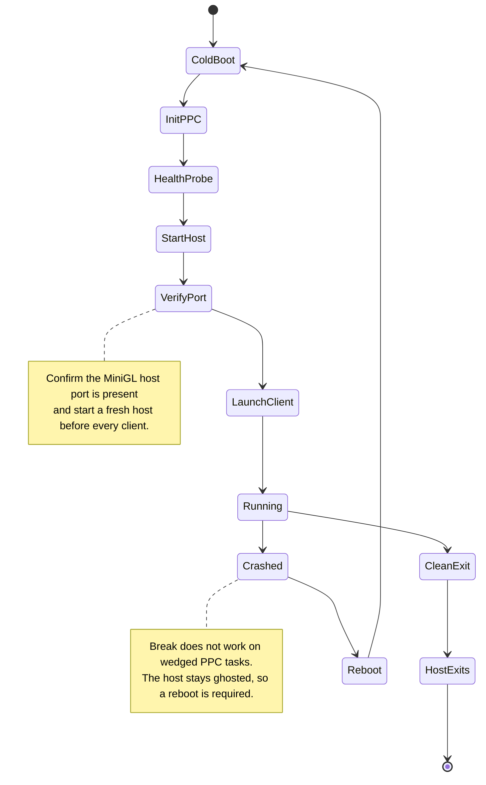

# Hardware session runbook

This is the operating procedure for the physical A4000 (MPC7410 WarpOS PPC +
68060 + Prometheus + Radeon 9200) used for development and benchmarking. It
exists because a wrong step costs a reboot: the MiniGL host stays ghosted after
a client crash and `Break` cannot kill wedged PPC tasks.

Read [targets/warpos.md](../targets/warpos.md) for the platform landmines this
procedure works around.

## Session state machine

<!-- mmd: hardware-session.mmd -->


## Per-run protocol

1. **Cold boot preferred.** Warm reboots can leave PPC executables broken
   (they die silently before `main`, including previously validated binaries).
   After **any** client crash: full reboot before the next run. A crashed
   client ghosts the host; wedged Software-Failure processes hold PPC RAM, so
   later launches can fail with "not enough memory".
2. `C:InitPPC` — **exactly once per boot**, after the boot is complete.
3. **Health check before starting the host** (a broken launch would eat a host
   lifecycle): run a known-good probe, e.g.
   `Run >NIL: Work:wosbuild/gqprobe >Work:wosbuild/hc.log`. Expect
   "MiniGLOpen failed" (no host yet), but **not** a crash. A historically
   validated binary is the only reliable PPC health check.
4. Start the host, wait ~8 s, then verify the host port
   `MiniGLPPC.R200.Host.1` exists:
   `Run >NIL: Execute Work:ibdraw/gqhostrun`.
   **Start a fresh host before every client launch**; a stale host makes the
   next client hang in `MiniGLOpen`/`mglCreateContext`.
5. Launch the client with `Stack 1048576`, CWD = the directory containing
   `minigl_ppc.dll`, and CRC-verified binaries. For demo playback:
   `Run >NIL: glquakeWOS -width 640 -height 480 -bpp 16 -noudp -nosound ...`.
   **For sound, AHI must be set to a DMA mode** (e.g. `Paula:DMA 8 bit
   stereo`); CPU-mixing Paula modes cost ~4-5 ms/frame on the shared 68060.
   The client prints a note when the selected mode is not a DMA mode. Do not
   use `-condebug` for benchmark runs (~4 fps of log I/O).
6. **Quit through the game** (ESC → Quit) or the window close gadget.
   **Never `Break`.** The host exits after a clean client close; a crashed
   client leaves it ghosted → reboot.

**Optional front-end.** The 68k
[BlitzQuakePPC MiniGL Launcher](launcher.md) automates steps 3–5 from one
window: it starts `mglhost` from the game drawer, verifies the host port and
launches the client with the selected options in the background. It cannot
recover a ghosted host, so the reboot rules above still apply.

## Benchmark protocol

Single samples are not results. The measured first-run-after-boot penalty is
1–9%, so follow this:

1. One variable per series (`gl_texsort`, `r_worldbatch`, DLL, chip driver,
   env vars), everything else pinned.
2. Prefer same-boot interleaved A/B where possible; otherwise three cold-boot
   runs per configuration and compare medians.
3. Always record the full identities: client CRC, DLL CRC, host CRC, chip
   driver CRC, `minigl.library` CRC, environment (`MGLPPC_CPEMIT` etc.),
   command line and resolution.
4. Use `-benchmarkquit -benchmarklog <file>` so the result is written after
   the timed interval (no I/O during measurement) and the client exits.
5. A gain below **2%** is noise and is not a reason to keep new architecture.
6. Parity metrics for any renderer change: draw records, input/submitted
   vertices, execute/wait failures, RHW clamps, plus a screenshot.
   `failed=0` and the expected presents count (978 for a 969-frame timedemo)
   are the minimum health signal.
7. Never benchmark on a run that had a failed or wedged client, a degraded
   warm boot, or a host that was not freshly started.

Reference command shape (adjust paths/resolution):

```text
DH2:wosbuild/q260/q260 -width 800 -height 600 -bpp 32 -noudp -nosound \
  -frameprofile DH2:wosbuild/q260/a32.fp -framewindow 250 270 \
  -benchmarkquit -benchmarklog DH2:wosbuild/q260/a32.txt \
  -condebug +timedemo demo1
```

`+cvar value` arguments set cvars at startup; `timedemo demo1` (the demo name,
not `1.dem`) plays the 969-frame benchmark. `host_speeds 1` and `r_speeds 1`
can be enabled for coarse buckets but change timing.

## Deployment pipeline (WOS)

```
build → zip → push → UnZip → Elf2Exe2 → Copy to game dir → CRC verify
→ fresh host → run
```

- Compress before pushing (bridge `push_file` times out above ~450 KB), then
  `UnZip -o` on the Amiga and verify CRC32 on both ends.
- Serialize all Amiga filesystem/DOS operations; never run them in parallel.
- `Elf2Exe2` must run in a foreground command with output captured
  (`Elf2Exe2 in out >capture.txt`); failures are silent otherwise.
- Keep exactly one `minigl_ppc.dll` in `Work:games/quake`. If
  `MGL_DLL_OVERRIDE` baked `Work:ibdraw/minigl_ppc.dll`, a stale game-dir copy
  is ignored — but check the baked path of the deployed client nevertheless.

## Recovery procedures

| Symptom | Cause | Recovery |
|---|---|---|
| Next client hangs in `MiniGLOpen`/`mglCreateContext` | Stale/ghosted host after a crash | Reboot; ensure a fresh host per client. |
| "not enough memory available" on launch | Wedged crash processes holding PPC RAM | Reboot. |
| PPC executables die silently before `main` | Degraded warm boot | Full cold power cycle. |
| No host port after starting host | Host died on startup | Reboot, redo InitPPC once. |
| `gqprobe` crashes in the health check | Broken PPC state | Cold power cycle; do not start the host. |
| Silent 2× slowdown / degraded loads | Degraded boot after chained InitPPC+launch | Fresh boot with strict one-command sequencing. |

Two bridge caveats to remember:

- The bridge crash handler only catches bridge-launched clients; `Run`'d
  clients leave `amiga_last_crash` empty.
- `Status` shows only the 68k view: wedged PPC clients appear as their 68k
  loader and cannot be killed.

## Production-stack references

When restoring the known-good WOS stack, the artefact identities are recorded
in [performance/README.md](../performance/README.md) and the history logs.
The production pair (as of the last recorded session) is client `6B7B0938`,
DLL `083A9E15` (W-10), host `F0343E03`, chip `39C2F8AF`,
`minigl.library` `62343673`. Always confirm the currently deployed pair
against the latest entry in
[performance/history/](../performance/history/) before assuming.

Rollback copies live on the target under `DH2:wosbuild/` (e.g. `dll.w10q`,
`dll.pre-fast`, `hpreclean`). Do not delete them; they are the recovery chain.

2026-09-22 sound update: `Work:games/quake/glquakeWOS` is client `A44967F5`
(native `dcbf` flush, hidden Amiga pointer, `-sndflush`/`-ahiid` options);
the previous client is `Work:games/quake/glqWOS.prefl` (`6B7B0938`). Sound
requires an AHI DMA mode to be fast; see
[performance/history/AHI_DMA_MODE_2026-09-22.md](../performance/history/AHI_DMA_MODE_2026-09-22.md).

2026-09-22 keyboard update: `Work:games/quake/glquakeWOS` is client `150B4144`
(739 272 B). `VID_ConfigureInputWindow` now calls `ActivateWindow()` on the
Quake window, so the keyboard works when the client is started in the
background (MiniGL launcher, `Run >NIL:`). Rollback is
`Work:wosbuild/glquakeWOS.new` (`A44967F5`, 739 068 B). No benchmark was run
for this change; the activation call is a no-op once the window is active.

2026-09-22 input-pack fix (supersedes the keyboard update and its
`ActivateWindow` experiment): keyboard, mouse look and mouse now all work on
hardware. Root cause: the WOS GCC build decoded `struct Window`/
`IntuiMessage`/`IntuitionBase` at PowerUp 4-byte offsets (+2 shift) because
`#pragma amiga-align` is ignored by GCC; fixed by `#pragma pack(push,2)`
around the OS includes in all input-touching TUs (details in
[targets/warpos.md](../targets/warpos.md#the-blitzquake-input-pack-fix-2026-09-22-keyboard--mouse-on-wos)).
Deployed release client: source ELF `7799A262` (1 092 044 B, `DIAGNOSTICS=0`)
→ exe `F81DB27D` (739 408 B). The tested diagnostics build
(`E3606F67`, 742 160 B) is kept at `Work:wosbuild/glquakeWOS.diag`; it is the
one that produces `Work:wosbuild/gqtrace` (release builds compile the trace
calls out). The launcher no longer passes `-stdout`. Rollback chain:
`Work:wosbuild/quakekb/glquakeWOS5` (keyboard only, `00817152`),
`Work:wosbuild/glquakeWOS.new` (`A44967F5`).

## Cleanup best practices

- Delete stale scratch directories that contain old DLL copies; a stale DLL
  once silently resurrected fixed defects in the game directory.
- Keep evidence directories (`DH2:wosbuild/qwait`, `qprof`, …) until the
  corresponding log entry is committed to `docs/performance/history/`.
- After a session, leave the machine idle with no client/host resident and
  document whether `InitPPC` was left initialized.
