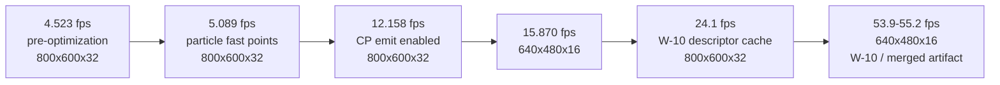

# Performance status

Living summary of the 2026 Amiga performance work. Raw session logs are in
[history/](history/); this page is the current state and the entry point.
**When you measure something new, update this page and add a dated log to
`history/`.**

## Snapshot (last updated 2026-09-22)

- The WOS client runs on the physical A4000/MPC7410 + RV280 stack with sound
  (high-level AHI) and bsdsocket networking enabled.
- Best recorded timedemo results are in the **mid-50s to ~61 fps at
  640×480×16 fullscreen** and **~24 fps at 800×600×32**, on the main-branch
  MiniGL pair. Exact artifact identities differ between sessions — see
  [Latest recorded configurations](#latest-recorded-configurations).
- `MGLPPC_CPEMIT=1` is the single largest win (+~2.4× on Quake, +39% on
  gears) and moved the bottleneck from the 68k host to the GPU frontend.
- The A1/A1b batching line is closed (hardware-falsified); W-80 fence
  coalescing is parked. Do not retry either — see
  [../decisions/REJECTED_PATHS.md](../decisions/REJECTED_PATHS.md).
- The frame-260 lightmap-upload hitch was fixed with the direct-recommit path
  for lightmap-class uploads.

<!-- mmd: performance-timeline.mmd -->

## Benchmark environment

- **Machine:** Amiga 4000, 68060 host, MPC7410 PPC 400 MHz, Prometheus +
  Radeon 9200 (RV280), WarpOS. MiniGL V19 stack (`minigl_ppc.dll` + 68k
  `mglhost`), `minigl.library` v12, Picasso96 Prometheus.card 7.602 +
  Radeon9200.chip 3.0.
- **Primary workload:** `timedemo demo1`, 969 timed frames, fullscreen,
  `-noudp -nosound` unless stated, three buffers, video sync off.
  `-benchmarkquit -benchmarklog <file>` writes the result after the timed
  interval.
- **Parity/health signals:** `failed=0`, 978 presents for a 969-frame
  timedemo, expected dispatch/vertex counts, screenshot check.
- **Statistics:** three cold-boot runs, median; same-boot interleaved A/B
  when possible. First-run-after-boot penalty is 1–9%; gains below 2% are
  noise. Full protocol: [../operations/runbook.md](../operations/runbook.md).

## Measured milestones

| Date | Configuration | Resolution | FPS | Log |
|---|---|---|---:|---|
| 2026-09-19 | Pre-optimization baseline | 800×600×32 | 4.523 | [results](history/PERFORMANCE_RESULTS_2026-09-19_2339.md) |
| 2026-09-19 | Particle fast points (1 px) | 800×600×32 | 5.089 | [results](history/PERFORMANCE_RESULTS_2026-09-19_2339.md) |
| 2026-09-19 | **CP emit enabled** | 800×600×32 | 12.158 | [results](history/PERFORMANCE_RESULTS_2026-09-19_2339.md) |
| 2026-09-20 | CP emit, 16-bit | 800×600×16 | 15.009 | [results](history/PERFORMANCE_RESULTS_2026-09-19_2339.md) |
| 2026-09-20 | CP emit, 16-bit | 640×480×16 | 15.870 | [results](history/PERFORMANCE_RESULTS_2026-09-19_2339.md) |
| 2026-09-20 | W-10 descriptor cache DLL | 640×480×16 | 55.182 | [results](history/PERFORMANCE_RESULTS_2026-09-19_2339.md) |
| 2026-09-20 | W-10 / W-11 tie | 800×600×32 | 24.117 / 24.069 | [results](history/PERFORMANCE_RESULTS_2026-09-19_2339.md) |
| 2026-09-20 | Session-4 matrix (quiet production client) | 800×600×32 / 640×480×16 | 23.611 / 52.097 | [results](history/PERFORMANCE_RESULTS_2026-09-19_2339.md) |
| 2026-09-20 | Frame-260 fix (qfix4) | 800×600×32 / 640×480×16 | 24.128 / 54.377 | [investigation](history/FRAME260_INVESTIGATION.md) |
| 2026-09-21 | Merged MiniGL canonical pair | 640×480×16 | **53.893** | [investigation](history/FRAME260_INVESTIGATION.md) |
| 2026-09-21 | A1b end-state (`wb0`) | fullscreen | **61.407** | [workstream A](history/WORKSTREAM_A_RENDERER_PLAN.md) |

> Numbers from different sessions sit on different DLL/host pairs. Compare
> only within one series unless the artifacts match exactly. The 61.407 fps
> end-state is the newest recorded validation (uncommitted workstream A1b
> note); that log does not restate the resolution, so confirm it before
> quoting a mode. The merged-artifact confirmation recorded 53.893 fps on its
> own pair at 640×480×16.

## Latest recorded configurations

| Session | Client | MiniGL DLL | 68k host | Result |
|---|---|---|---|---|
| A1b final (2026-09-21) | `DH2:wosbuild/qitem2/glqfinal` (`689D74EC`) | `7FD5776D` (`Work:ibdraw/minigl_ppc.dll` and `Work:games/quake/minigl_ppc.dll`; warpelf `7104759E`) | `EFDF7EAC` | `wb0` 61.407 fps |
| Merged artifact confirmation (2026-09-21) | merged pair | `bin/minigl_ppc_r200.warpelf` `E241EE4B` → target `53145132` | `bin/minigl_ppc_host` `EFDF7EAC` | 53.893 fps, 48/48 direct BEGINs, frame 260 42.3 ms |
| Frame-260 fix (qfix4) | `489C7BF2` | target `CE3B2B2E` | — | 24.128 / 54.377 fps; frame 260 167.7→105.1 / 113.7→40.9 ms |
| W-10 production reference | `6B7B0938` | `083A9E15` | `F0343E03` | 55.182 fps @ 640×480×16 |

Environment for all of the above unless noted: `MGLPPC_CPEMIT=1`,
`ENVARC:MGLPPC_HOSTPRI=-1`, client task priority 5 (`-clpri`), no
`MGLPPC_VERBOSE`/`MGLPPC_UPLOAD_TRACE`.

## What actually limits the frame

1. **Frontend per-vertex work dominates** (TCL staging, per-vertex fog,
   `EmitPrimitive`). Every submission route pays it; that is why batching
   lost.
2. **GPU-retirement fences**: ~95% of attributed publish wait at
   800×600×32; the wait scales with fill (6× drop at 16-bit). The remaining
   lever is fewer dispatches per frame, not driver fence surgery (W-80
   parked).
3. **Lightmap upload residency churn**: ~16 ms per upload before the
   direct-recommit fix; per-frame upload count is the metric. Coalescing the
   four per-frame uploads is still open.
4. **Sound**: ~0 ms/frame over `-nosound` with AHI in **DMA mode**
   (54.9-55.4 vs 55.3 fps, 2026-09-22). CPU-mixing Paula modes cost
   ~4-5 ms/frame on the shared 68060; the old design cost ~30 ms/frame.
   See [history/AHI_DMA_MODE_2026-09-22.md](history/AHI_DMA_MODE_2026-09-22.md).
5. **68k host is exonerated** under CP emit: ~2.6% stall share, 249 ms
   total drain in a 40.8 s run.

## Artifacts and rollback

Deployed/rollback copies are tracked on the target under `DH2:wosbuild/` and
`Work:games/quake`. Known rollback chain from the batching workstream:
`.pre-fp` (32K FastPath), `.pre-max32k` (16K), `.pre-max16k` (8K),
`.pre-max8k` (original W-10 DLL; host `mglhost.pre-max8k`). The W-10 pair
(`083A9E15` / `F0343E03`) plus the user-validated DLL (`FCEF7CE9`) and host
(`FB712873`) are the historical references.

**Do not delete rollback copies on the target**; they are the recovery chain
for a bad deployment.

## Open items

1. **Coalesce per-frame lightmap uploads** (client-side): frame 260 still
   issues four; gathering dirty atlases once per frame would remove further
   residency re-imports. Measure frame-260 and the P95 tail.
2. **Atlas-3 lead barrier** (~42 ms at 32-bit) is the CP-wait lever; revisit
   through fewer dispatches per frame, not fences.
3. **Windowed-mode slowdown** on the main-branch DLL (18–20 fps vs 86 fps
   on W-10) is unresolved; fullscreen is unaffected.
4. **Session-4 stack promotion (W-70/W-71)** for the 640×480×16 and
   800×600×32 targets was still pending as of the last log.
5. ASL ScreenModeRequester in `VID_Init` (user request, not started).
6. Optional: extend the direct upload class to RGB/RGBA uploads that
   provably carry no mips (needs a client-visible "no mip" signal; do not
   infer from `generated` or the mirror filter).

## History log

| File | Content |
|---|---|
| [GLQUAKE_WOS_HANDOVER.md](history/GLQUAKE_WOS_HANDOVER.md) | 2026-09-13 bring-up handover: what ran, session protocol, open issues with status banners. |
| [OPTIMIZATION_CANDIDATE.md](history/OPTIMIZATION_CANDIDATE.md) | Pre-CP-emit work: binding cache, flash guards, particles; 4.5–5.1 fps plateau. |
| [PERFORMANCE_RESULTS_2026-09-19_2339.md](history/PERFORMANCE_RESULTS_2026-09-19_2339.md) | First optimization session results, correctness fixes, gears benchmark, session-4 matrix and first CP_WAIT attribution. |
| [PERFORMANCE_PLAN_2026-09-20_0024.md](history/PERFORMANCE_PLAN_2026-09-20_0024.md) | Full working plan and log: profiler design, W-01…W-12 descriptor cache, W-80 fence work (parked), deploy checklists, runbooks. |
| [FRAME260_INVESTIGATION.md](history/FRAME260_INVESTIGATION.md) | Frame-260 hitch attribution, deep host/PPC per-upload split, direct-path fix. |
| [AHI_DMA_MODE_2026-09-22.md](history/AHI_DMA_MODE_2026-09-22.md) | Sound cost root cause: ring-size flush bug fixed, native `dcbf` flush, AHI DMA mode removes the ~5 ms/frame driver cost. |
| [WORKSTREAM_A_RENDERER_PLAN.md](history/WORKSTREAM_A_RENDERER_PLAN.md) | Renderer batching plan (A1–A6), implementation notes, hardware verdicts. |
| [STEP4_REJECTED_GENERIC_ARRAY_PATH.md](history/STEP4_REJECTED_GENERIC_ARRAY_PATH.md) | 68k R200 decision record for the rejected per-polygon array path. |
| [MiniGL_R200_BUG_REPORT.md](history/MiniGL_R200_BUG_REPORT.md) | Defect report sent to the MiniGL developer (textures, uploads, screenshot no-op). |

When adding a log: use a dated filename, add an archive banner linking back
here, update this table, and record artifact CRCs and the exact command line.
