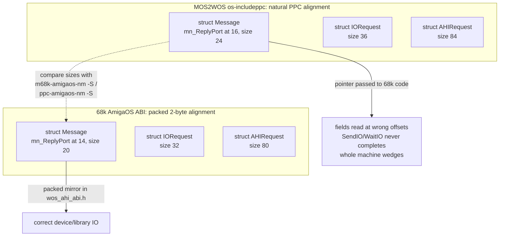

# WarpOS/PPC target guide

Target: **Amiga 4000, MPC7410 WarpOS PPC card, Prometheus + Radeon 9200,
MiniGL V19 WOS stack** (`minigl_ppc.dll` + 68k `mglhost`). Cross-build on
Linux with `ppc-amigaos-gcc` + the MOS2WOS SDK overlay.

This page collects the toolchain/runtime landmines learned while porting to
this stack. They are ordered roughly by how much time they cost. Read
[building.md](../building.md) for the build command and
[operations/runbook.md](../operations/runbook.md) for the session protocol.

Contents:

1. [Toolchain](#toolchain)
2. [ET_REL link contract (warpelf)](#et_rel-link-contract-warpelf)
3. [Deployment over the bridge](#deployment-over-the-bridge)
4. [MOS2WOS runtime landmines](#mos2wos-runtime-landmines)
5. [The packed-struct ABI trap](#the-packed-struct-abi-trap)
6. [AHI on WarpOS](#ahi-on-warpos-use-the-q3-high-level-scheme)
7. [68k-isms that become fatal on PPC](#68k-isms-that-become-fatal-on-ppc)
8. [MiniGL V19 WOS client session protocol](#minigl-v19-wos-client-session-protocol)
9. [MiniGL R200 frontend restrictions](#minigl-r200-frontend-restrictions)
10. [Porting landmines hit in the game path](#porting-landmines-hit-in-the-game-path-client-bugs)
11. [Debugging techniques that worked](#debugging-techniques-that-worked)
12. [BlitzQuake-specific fixes applied](#blitzquake-specific-fixes-applied)
13. [Launch recipe](#launch-recipe)

## Toolchain

- Compiler: `/home/mirek/ppc-amigaos-gcc/native-build/root-cross/bin/ppc-amigaos-gcc`
  (adtools GCC 8.4.0, targets AmigaOS4; fine for WarpOS with the right flags).
- SDK: MOS2WOS overlay at `/home/mirek/Downloads/gg/ppc-warpos`
  (`os-includeppc`, `include`, `netinclude`, `newlib`, `lib`).
- Shared config: `~/MiniGL_WOS_V19_mglQ3/Makefile.wos.gcc.common`
  (`WOS_ARCH_CFLAGS`, `WOS_CPPFLAGS`, ET_REL link contract + `WOS_VALIDATE_ETREL`).
- CFLAGS recipe for 2002-era C: `-std=gnu89 $(WOS_ARCH_CFLAGS) -O2 -w`.
  `-fno-jump-tables` is MANDATORY (ET_REL relocation contract).

## ET_REL link contract (warpelf)

```
ppc-amigaos-ld -r -EB -d -x -T warpos-etrel.ld \
    -L$SDK/newlib/lib -L$SDK/lib -o out.warpelf \
    $SDK/lib/startupwos.o  <objects...> <archives...> \
    --start-group -lamigawos -lgccwos -lm -lglosswos -lcwos -lglosswos -lgccwos --end-group \
    $SDK/lib/end.o
```

- `startupwos.o` MUST be first (`_start` at `.text+0`).
- Validate after link: zero undefined symbols, no COMMON symbols, only
  `R_PPC_ADDR32 / R_PPC_ADDR16_LO / R_PPC_ADDR16_HA / R_PPC_REL24` relocations
  (see `WOS_VALIDATE_ETREL` in Makefile.wos.gcc.common).
- **Elf2Exe2 (on the Amiga, needs ixemul V48) rejects undefined symbols** with
  `Error: Undefined Symbol: <name>` and exits. Always run
  `nm --undefined-only out.warpelf | wc -l` locally before deploying.
  A failing Elf2Exe2 run produces no output file and (without redirect) no
  visible error — always redirect: `Elf2Exe2 in.elf out >capture.txt`.
- Stripping the ELF before conversion is harmless (output identical), skip it.
- Converting a ~1 MB ELF takes ~30 s on the 68060; do it in a foreground
  `dos_command` with output captured, not inside long batch scripts.

## Deployment over the bridge

- `push_file` times out above ~450 KB. Compress locally (python zipfile),
  push the ZIP, `UnZip -o x.zip -d Work:wosbuild` on the Amiga, then CRC32
  verify both ends (`amiga_checksum` vs local `zlib.crc32`).
- NEVER run parallel Amiga filesystem/DOS operations; serialize everything.
- Amiga-side names ≤ 16 characters.
- Don't write mega-batch scripts through `run_script` — the MCP layer times
  out (~120 s) and leaves half-executed state on the Amiga. Do steps
  individually and verify each artifact.

## MOS2WOS runtime landmines

These are the ones that cost days:

1. **Library bases are YOURS to define and open.** The old PowerUp toolchain's
   `libppcamiga` auto-defined/auto-opened bases. MOS2WOS does not:
   - `TimerBase` is declared `extern struct Library *` by `proto/timer.h` —
     define it with EXACTLY that type (`struct Library *`, not `struct Device *`).
   - `IntuitionBase`, `GfxBase` etc.: define them yourself and open the
     libraries (we open intuition.library + graphics.library in `VID_Init`).
   - `PowerPCBase`: referenced by libglosswos/libcwos/libgccwos internals.
     Leaving it NULL is FINE for the libglosswos fallback paths
     (printf/write/open/malloc all work with NULL).
2. **NEVER `OpenLibrary("ppc.library")` from a PPC task.** ppclibemu's
   per-task 68k emulation init crashes (PowerPC Exception, PC=0). Same for
   `GetSysTimePPC`/`GetSysTime`/`SubTimePPC` (PowerUp LVOs -684/-66...).
3. **timer.device `ReadEClock`/`GetSysTime` LP calls crash from a PPC task**
   on this stack. The validated MiniGL gears client replaced PPC timing with
   `DateStamp()` (dos.library, 1/50 s). Use DateStamp. (Most likely the same
   packed-struct ABI trap as below — the timerequest layout is wrong too;
   not re-tested because DateStamp is sufficient.)
4. **`usleep()` crashes when PowerPCBase is NULL** (libglosswos sleep path).
   Use dos `Delay()`.
5. **exec/dos inline calls work** via `proto/*.h` → `powerup/ppcinline/*.h`
   LP stubs (validated: OpenLibrary, Open/Write, CreateMsgPort, sockets).
   `powerup/ppcproto/exec.h` and `proto/exec.h` are the same mechanism —
   MOS2WOS ships both spellings and both are safe.
6. **Sockets: two incompatible header sets.** `os-includeppc/clib/bsdsocket_protos.h`
   (AmigaOS `LONG` signatures) vs `netinclude/sys/socket.h` (BSD-style,
   `__P*` macros → libglosswos implementations). Never include both.
   - The `__P*` POSIX layer works: `socket()`, `bind()`, `connect()`,
     `gethostbyname()` etc. (libglosswos owns `SocketBase`, auto-opened by
     its `__init_bsdsocket` constructor; do NOT define `SocketBase` yourself).
   - fd values from `socket()` are libglosswos fd-table indices, NOT raw
     bsdsocket handles: raw `CloseSocket`/`IoctlSocket` on them return -1.
   - If you ever go all-raw instead, the Amiga-named entry points
     (`CloseSocket`, `IoctlSocket`, `Inet_NtoA`, `SocketBaseTagList`) need LP
     inline macros copied verbatim from `powerup/ppcinline/bsdsocket.h`
     (including `#include <powerup/ppcinline/macros.h>` + `#define
     BSDSOCKET_BASE_NAME SocketBase`) — but then never mix them with the
     `__P*` layer (see RESOLVED below).
   - **RESOLVED (2026-09-20): use all-`__P*`.** libglosswos provides
     `ioctl()` (`FIONBIO` via `<sys/filio.h>`) and `close()` (→
     `__close_socket`), opens `bsdsocket.library` v4 lazily and sets
     `SBTC_ERRNOLONGPTR`/`SBTC_LOGTAGPTR` itself. `net_bsdsocket.c` now uses
     only the `__P*` layer — no raw `CloseSocket`/`IoctlSocket`/`Inet_NtoA`/
     `SocketBaseTagList`. Do not `CloseLibrary(SocketBase)` at shutdown:
     libglosswos owns it and closes it in its `.fini` destructor.
   - **errno numbering**: the stack writes AmiTCP/Roadshow errno values
     through `SBTC_ERRNOLONGPTR`, but newlib's `<errno.h>` in this SDK uses a
     different numbering for some codes (`ECONNREFUSED` 61 on the stack vs
     111 in newlib; `EWOULDBLOCK` happens to be 35 in both). Use explicit
     constants (`NET_EWOULDBLOCK`/`NET_ECONNREFUSED` in `net_bsdsocket.c`).
   - Verified on hardware with the `wos_net` probe: socket/bind/
     ioctl(FIONBIO)/sendto/recvfrom/close, gethostname/gethostbyname and the
     `LittleLong`/`LittleShort` wire conversions all work; non-blocking recv
     on an empty socket returns `errno=35`.
   - This Roadshow install has **no loopback interface** (`ShowNetStatus`
     shows only the RTL8139 at 192.168.1.21), so 127.0.0.1 tests never
     receive. Test against the machine's own interface address or a real
     peer.
7. **`#pragma amiga-align` is ignored by GCC** — do not rely on it. The
   MOS2WOS `os-includeppc` headers therefore use natural PPC alignment,
   which does **not** match the 68k ABI; see the next section before
   passing any struct to 68k code.

## The packed-struct ABI trap

(The original notes for this section called it the "packed-layout trap".)

<!-- mmd: abi-alignment.mmd -->


The MOS2WOS `os-includeppc` headers are OS4-style: `struct Message`,
`IORequest`, `IOStdReq`, `Library`, ... get **natural PPC alignment**. Every
68k library and device expects the **packed AmigaOS layout** (2-byte
alignment). `#pragma amiga-align` is a no-op with this GCC, so the mismatch
is silent. Calls that pass only scalars or opaque pointers work
(`CreateMsgPort`, `OpenLibrary`, `DateStamp`, `AllocMem`, sockets,
`Open/Write/Close`), but anything that passes a struct **by pointer** to 68k
code is broken: the 68k side reads `io_Message.mn_ReplyPort`, `io_Length`,
`ahir_Type`, ... at the wrong offsets.

Measured with both compilers (recipe below):

| struct | 68k (correct) | PPC MOS2WOS (natural) |
|---|---|---|
| `Message` size / `mn_ReplyPort` / `mn_Length` | 20 / 14 / 18 | 24 / 16 / 20 |
| `IORequest` size / `io_Device` / `io_Command` | 32 / 20 / 28 | 36 / 24 / 32 |
| `IOStdReq` size / `io_Length` / `io_Data` | 48 / 36 / 40 | 52 / 40 / 44 |
| `AHIRequest` size / `ahir_Type` / `ahir_Link` | 80 / 60 / 76 | 84 / 64 / 80 |
| `Library` size / `lib_Version` / `lib_IdString` | 34 / 20 / 24 | 40 / 22 / 28 |

Symptom: `OpenDevice("ahi.device")` returns 0, then `SendIO` + `WaitIO`
never completes (the reply port was written at the wrong offset), and the
whole machine wedges. This was first misread as "powerpc.library: Async
Run68K function not supported" / a broken AHI interrupt path — it was purely
the ABI. The same explanation applies to the earlier timer.device
`GetSysTime`/`ReadEClock` crashes (the timerequest layout is wrong too).

**How to do it:** define your own `__attribute__((packed))` mirror structs
with the 68k layout and use those for the device/library call.
[`glquake/wos_ahi_abi.h`](../../glquake/wos_ahi_abi.h) provides
`wos_Message`, `wos_IORequest`, `wos_IOStdReq`, `wos_AHIRequest`,
`wos_Library` plus compile-time size guards; `snd_amiga_AHI.c` typedefs
`ahi_request_t` to the packed type under `WOS`. Note the MOS2WOS `IOStdReq`
inlines the `IORequest` fields (there is no `io_Request` member), so
`ahir_Std.io_Error` works — the packed mirror keeps that shape.

Validated on real hardware (probe `wos_ahi`, 2026-09-20):
`OpenDevice` v4 OK, `CMD_WRITE` + `WaitIO` `io_Error=0`, `CheckIO` polling
`io_Error=0`, linked double-buffer streaming produced exactly 2 buffer
completions in 3 s for a 1.49 s ring — audio audible.

Rules of thumb:

- Passing a *pointer* to a 68k object you never dereference (MsgPort,
  library base, BPTR, socket fd) is safe.
- Reading a field of a 68k struct from PPC through these headers is **not**
  safe: `IntuitionBase->FirstScreen`, `GfxBase->DisplayFlags`,
  `AHIBase->lib_Version` all sit at wrong offsets. Wrap them in a packed
  mirror struct or avoid the read.
- `netinclude` is the exception: it already forces `pack(2)` under `__PPC__`,
  so `sockaddr_in`, `hostent`, ... are 68k-correct (verified on hardware).
- Never rely on `#pragma amiga-align`; it is a no-op with this GCC.

### The BlitzQuake input-pack fix (2026-09-22, keyboard + mouse on WOS)

Concrete case of the trap, and the reason the WOS client's keyboard and mouse
were completely dead while Q3's input worked with the same MiniGL DLL:
`gl_vidamiga.c` (and several siblings) included `intuition/intuition.h` under
`#pragma amiga-align`, which the PPC GCC build ignores. `struct Window` and
`struct IntuiMessage` therefore decoded at PowerUp 4-byte offsets, +2 bytes
past the real Amiga 2-byte layout from `IDCMPFlags` onwards. Consequences:
`IDCMPFlags`/`UserPort`/`WScreen` read garbage (a *stale port pointer*,
never a `SEGV`), `GetMsg(UserPort)` saw nothing, and
`IntuitionBase->ActiveWindow` in `IN_MouseMove` (`in_amigamouse.c`) never
equalled `QuakeWindow`, silently disabling mouse look. Mouse buttons still
arrived through the RAWKEY/MOUSEBUTTONS pump in the (later packed)
`gl_vidamiga.c`, which is why "keyboard works, buttons work, mouse look does
not" was the observable split.

Fix: replace the ignored pragma with `#pragma pack(push,2)` /
`#pragma pack(pop)` around the OS include blocks, gated to
`defined(__GNUC__) && defined(__PPC__)` so the 68k dispatch build is
untouched (Q3 does exactly this around its system headers). Patched WOS-build
TUs: `gl_vidamiga.c`, `in_amigamouse.c`, `in_amigajoy.c`, `in_amigapsx.c`,
`miniglext.c`, `net_bsdsocket.c`, `snd_amiga_AHI.c`, `sys_amiga_std.c`,
`sys_amigaclip.c` and `sys.h`. Verified in the compiled objects: the input
poll loads `UserPort` at offset **86** (not 88) and `ActiveWindow` at **52**
(not 56); on hardware the client trace shows a sane
`win/port/flags/idcmp/screen` capture, `idcmp=0x00100418` exactly as
requested, and RAWKEY messages arriving. `ActivateWindow()` from an earlier
attempt was removed (Q3 does not call it; the host opens the fullscreen
window with `WFLG_ACTIVATE` already). The input setup is otherwise Q3
parity: `mglGetWindowHandle()` only, mask **replaced** with
`RAWKEY|MOUSEBUTTONS|MOUSEMOVE|DELTAMOVE`, `win->Flags |= WFLG_REPORTMOUSE`.

### Measuring a struct ABI locally (no hardware needed)

Declare one uninitialised global array per size/offset; each becomes a
COMMON symbol whose `nm -S` value *is* the size/offset:

```c
#include <stddef.h>
#include <exec/types.h>
#include <exec/ports.h>
#include <exec/io.h>
#include <devices/ahi.h>
char size_Message[sizeof(struct Message)];
char off_msg_replyport[offsetof(struct Message, mn_ReplyPort)];
char size_AHIRequest[sizeof(struct AHIRequest)];
char off_ahi_type[offsetof(struct AHIRequest, ahir_Type)];
```

```sh
# 68k (AmigaOS 3.x headers = packed ABI)
/opt/amiga/bin/m68k-amigaos-gcc -std=gnu89 -c abi.c -o abi68k.o
/opt/amiga/bin/m68k-amigaos-nm -S abi68k.o
# PPC (MOS2WOS headers)
ppc-amigaos-gcc -std=gnu89 -mcpu=604e -mbig-endian -nostdinc -D__PPC__ \
  -DWARPUP -DNEWLIB -isystem $WOS_SDK_ROOT/newlib/include \
  -isystem $WOS_SDK_ROOT/os-includeppc -isystem $WOS_SDK_ROOT/include \
  -c abi.c -o abippc.o
ppc-amigaos-nm -S abippc.o
```

If the two columns differ, add a packed mirror struct for that object.

## AHI on WarpOS: use the Q3 high-level scheme (measured)

The first working AHI implementation here was McGavin's low-level
`ahi.device` double-buffer (2 linked `CMD_WRITE` requests, wall-clock play
position). It worked but cost ~30 ms/frame: the per-frame sound path issued
2 emulated LP calls (`DateStamp` for the position estimate + `CacheClearE`
for the DMA flush), and each Run68K call is milliseconds on this stack
(contended with mglhost on the shared 68060). Measured at 640x480x16
fullscreen, timedemo demo1, 969 frames:

| configuration | fps | ms/frame |
|---|---|---|
| low-level AHI + 2 LP calls/frame | 19.97 | 50.1 |
| `-nosound` baseline | 55.82 | 17.9 |
| **high-level AHI + effect hook (final)** | **44.82** | **22.3** |

The final implementation is a 1:1 port of `quake3amiga/code/amiga/amiga_snd.c`
(Quake 2 code by Jarmo Laakkonen / Hans-Joerg Frieden):

- `AHI_AllocAudio(AHIA_AudioID, AHI_DEFAULT_ID, AHIA_MixFreq, speed,
  AHIA_Channels, 1, AHIA_Sounds, 1, TAG_END)`; buffer size from
  `AHIDB_MaxPlaySamples * speed / mixfreq` (min 64 KB).
- `AHI_LoadSound(0, AHIST_DYNAMICSAMPLE, &sample, actrl)` +
  `AHIC_Play` + `AHI_Play(...)` + `AHI_SetEffect(AHIET_CHANNELINFO)`.
- **Play position from the AHI effect hook**: `ahieci_Offset[0]` is copied
  into `hook->h_Data` by a 68k code blob that AHI calls on every mix.
  `SNDDMA_GetDMAPos()` is then just `h_Data * channels` - no OS call.
- `AHIBase = (struct Library *)AHIio->ahir_Std.io_Device` (the Q3 trick);
  the AHI_* library vectors are reached through the device base.
- The 68k hook blob is a static `unsigned short[]` in the PPC executable's
  data (PPC RAM is visible/executable by the 68k); copy the exact 10 words
  from the Q3 source, do not rewrite it in C.
- Shutdown order: `AHIET_CANCEL` effect, `AHIC_Play FALSE`, `UnloadSound`,
  free buffer, `FreeAudio`, `CloseDevice`, `DeleteIORequest`, `DeleteMsgPort`.

Adaptation for this tree: the buffer is `malloc`'d because this runtime has
`PowerPCBase == NULL` (`AllocVecPPC` unavailable), so the PPC must push the
painted range to memory before the 68k driver reads it. `SNDDMA_Submit` now
uses a native `dcbf`+`sync` over the exact painted range (`-sndflush
native`, default); the old `CacheClearE` LP call remains as a fallback
(`-sndflush exec`). The earlier native attempt produced silence because the
range was masked with `AHIBUFFERSIZE` (256 KB, the old low-level constant)
instead of the real high-level ring size (`wos_buflen`, 64 KB): after ~1.5 s
of painting the flush targeted memory past the ring. `CacheClearE` had
hidden that bug because the LP stub flushes the whole PPC cache; a targeted
`dcbf` did not. The ring-size mask is fixed and hardware-validated
(`wos_cache` probe: the 68k sees `dcbf`'d fast-RAM data, and it does not
serve stale lines on the next read).

**The dominant sound cost is the AHI mode, not the flush.** With a
CPU-mixing Paula mode the driver mixes on the same 68060 that runs mglhost,
and the frame (which waits on the host) stretches by almost the same amount.
Measured 2026-09-22, 640x480x16 fullscreen, timedemo demo1, 969 frames,
same-boot runs:

| configuration (same client) | fps | ms/frame | vs `-nosound` |
|---|---|---|---|
| `-nosound` | 55.31 | 18.08 | - |
| old `CacheClearE` flush + Paula 14-bit calibrated | 41.55 | 24.07 | +5.99 |
| native flush + Paula 14-bit calibrated (`0002000d`) | 43.57 | 22.95 | +4.87 |
| native flush + Paula 8-bit HiFi stereo (`00020011`) | 45.45 | 22.00 | +3.92 |
| native flush + Paula 14-bit, `-audspeed 4000` | 51.32 | 19.48 | +1.40 |
| native flush + Paula 14-bit, `-audspeed 22050` | 30.84 | 31.42 | +13.34 |
| **native flush + AHI DMA mode (`00020018`)** | **54.87-55.37** | **17.5-17.7** | **~0** |

Select an AHI **DMA** mode (e.g. `Paula:DMA 8 bit stereo`) in AHI prefs for
full speed; CPU-mixing Paula modes cost several ms/frame and scale with the
mix rate (`-audspeed`). `-ahiid <hex>` overrides the mode for a single run
without touching the user's AHI preferences (enumerate modes with the
`wos_ahimodes` probe), and the game prints a note when the selected mode is
not a DMA mode. Do not benchmark with `-condebug`: console log I/O costs
~4 fps (51.0 vs 54.9 measured).

Also validated in the same session:

- `net_bsdsocket.c` pure `__P*` layer: real NetQuake `CCREQ_SERVER_INFO` and
  `CCREQ_CONNECT` exchanges against a little-endian x86 responder on the LAN
  decoded correctly (server name/map/players, and the `CCREP_ACCEPT` port as
  `LittleLong`).
- A cached per-frame wall clock (`WOS_FrameClockTick()` in `sys_amiga_std.c`)
  keeps all intra-frame `Sys_FloatTime()` callers on one `DateStamp` per
  frame instead of one per sound update.

## 68k-isms that become fatal on PPC

- **Reads from NULL/low memory.** On 68k, address 0-0x400 is readable (exec
  vectors), so bugs like `strcpy(dst, NULL)` or `GL_LoadTexture(identifier=NULL)
  → strcpy(glt->identifier, NULL)` silently "worked". On PPC the NULL page
  faults → PowerPC Exception. Guard every NULL that reaches str*/*printf*.
  (Found: `GL_LoadPicTexture` passes `identifier=NULL` into
  `GL_LoadTexture` which strcpy'd it — now guarded in `gl_draw.c`.)
- **Function pointers into unset tables**: Quake's `net_landrivers[]`/
  `net_drivers[]` config must match the linked driver set, else NULL calls.

## MiniGL V19 WOS client session protocol

- Client links `lib/libminigl.a`; at runtime `MiniGLOpen()` loads
  `minigl_ppc.dll` via the Hyperion loader. `Open("minigl_ppc.dll")` is
  CWD-relative → either put the exe next to the DLL, or compile
  `-DMINIGL_PPC_DLLNAME="\"Work:ibdraw/minigl_ppc.dll\""` (header supports
  the override; the maintained Makefile does this through
  `MGL_DLL_OVERRIDE`).
- Per session: cold boot → `C:InitPPC` **exactly once** → start the 68k host
  (`Run >NIL: Execute Work:ibdraw/gqhostrun`; Stack 65536; fresh host per
  client run; host exits after a client's clean `MiniGLClose`) → run client
  with CWD = the dir containing `minigl_ppc.dll`.
- **After ANY client crash the host is ghosted** — the next client hangs in
  `MiniGLOpen`/`mglCreateContext`. `Break` is ignored by wedged PPC processes;
  `Work:wosbuild/minigl_dll_kill` clears the DLL port but not the host
  attachment. The only reliable recovery is a REBOOT. Wedged crash processes
  also stay in `Status` and hold PPC RAM (later launches fail with
  "not enough memory available" from the loader).
- Keep `MGLPPC_VERBOSE`/`MGLPPC_UPLOAD_TRACE` unset (console writes dominate
  frame time; the trace string also breaks the Sonnet loader classifier).
- Validated GL strings on this stack: `MiniGL_R200 / Radeon3D semantic R200 /
  1.1 MiniGL_R200 phase6`, extensions `GL_ARB_multitexture
  GL_MGL_performance_counters`.
- Known no-ops on this stack: `mglResizeContext` (mode changes need a
  restart), `glClientActiveTextureARB`.

## MiniGL R200 frontend restrictions

Measured on the stack; see
[history/MiniGL_R200_BUG_REPORT.md](../performance/history/MiniGL_R200_BUG_REPORT.md)
for the original report and
[minigl-dispatch.md](../architecture/minigl-dispatch.md#frontend-restrictions-measured-on-this-stack)
for the client-side handling:

- `glTexImage2D` internalformat: **GL_RGBA and GL_LUMINANCE fail** (MiniGL
  error 0x59/0x58); **GL_RGB and GL_RGB5_A1 work**. MGL_UNSIGNED_SHORT_5_6_5
  also fails (game's `-lm_RGB` path unusable). Fixed in later DLLs; verify
  the deployed DLL CRC before assuming.
- `glTexImage2D` costs ~101 ms per call regardless of size — fixed latency,
  likely a blocking fence in the submit path. Level load ≈ 20-30 s from this
  alone.
- `glTexSubImage2D` ≈ 136 ms per 128×128 / 408 ms per 256×256 update before
  the frame-260 direct-recommit fix; Quake's per-frame lightmap updates made
  the game run at ~0.5 fps. Workaround history: static lightmaps only
  (texsub call sites compiled out under WOS; dynamic lights lost), later
  replaced by the direct class.
- `mglWriteShotPPM` is a silent no-op (no file, no GL error) — game
  screenshots don't work; don't trust bridge P96 grabs in fullscreen either.
- Draw calls / vertex dispatch / glClear are FAST (0.07-0.27 ms/quad,
  25-75 µs/vertex-pair, 2-7 ms/clear) — the GPU frontend itself is fine.

## Porting landmines hit in the game path (client bugs)

- `GL_LoadTexture(identifier=NULL)` → `strcpy(dst, NULL)`: tolerated on 68k
  (low memory readable), fatal on PPC. Guarded in `gl_draw.c`; see
  [68k-isms that become fatal on PPC](#68k-isms-that-become-fatal-on-ppc).
- AHI sound: the classic AHI interrupt/callback path from a PPC task triggers
  "powerpc.library: Async Run68K function not supported" — this is why the
  maintained WOS sound path is the high-level scheme
  [below](#ahi-on-warpos-use-the-q3-high-level-scheme) and why `-nosound` is
  kept as a clean fallback.
- **RESOLVED**: "PPC Memory corruption detected during freeing" during demo
  playback was the unused timer.device request being opened and torn down
  from the PPC task; timer open/cleanup is now `#ifndef WOS`
  (`glquake/sys_amiga_std.c`). It was detected at free time by
  powerpc.library; no heap stomp remained after the fix.

## Debugging techniques that worked

- **Warm reboots can leave WarpOS PPC broken**: after a warm reset, PPC
  executables (even historically-validated ones like `gears_v19`) die
  silently before `main` — no output, no requester, redirect files never
  created — while everything 68k keeps working (Elf2Exe2, mglhost, DOpus).
  `C:InitPPC` completing without error does NOT mean the PPC side works.
  **Always verify PPC health with a known-good binary after every boot
  before debugging your own code; recover with a full COLD power cycle.**
- **Direct-DOS trace file**: a helper that does open/append/close per line to
  `RAM:gqtrace` via proto/dos.h — independent of stdio (which may be broken
  when PowerPCBase paths are the problem). Sprinkle markers around init
  stages; the last marker = crash site.
- Live console: pass `-stdout` (Quake suppresses stdout otherwise) +
  `setvbuf(stdout, NULL, _IONBF, 0)` at main() entry + `Run >CON:.../NOCLOSE`.
- Crash numbers: Software Failure `#80000004` = illegal instruction (usually
  a call through a NULL/garbage function pointer). PowerPC Exception dump:
  `SRR0` = crash PC, `DAR` = faulting address (0x10/0 → NULL struct write),
  `DSISR 0x40000000` = store, `PVR 800C1104` = MPC7410.
- `Status` shows the 68k view only; wedged PPC clients appear as their 68k
  loader process and cannot be killed (`Break N C` ignored).
- The bridge crash handler only catches bridge-launched clients, not `Run`'d
  ones (`amiga_last_crash` stays empty).
- `Work:` volume (= old DH2:) survives warm resets; PPC RAM state does not.

See also the [archived handover](../performance/history/GLQUAKE_WOS_HANDOVER.md)
for the debugging recipes from the first bring-up, and
[operations/runbook.md](../operations/runbook.md) for the current protocol.

## BlitzQuake-specific fixes applied

- `snd_amiga_AHI.c`: guard `<powerup/ppcinline/alib.h>` (missing in MOS2WOS);
  WOS path is the Q3-style high-level AHI + `AHIET_CHANNELINFO` hook (see the
  AHI section above), packed `wos_AHIRequest` via `wos_ahi_abi.h`, graceful
  no-sound fallback, `-audspeed` honored.
- `sys_amiga_std.c`: one `DateStamp` per frame (`WOS_FrameClockTick()`),
  reused by all intra-frame `Sys_FloatTime()` callers.
- `net_bsdsocket.c`: WOS branch is pure `__P*` (no raw bsdsocket LP calls);
  `ioctl(FIONBIO)`/`close()`; stack errno constants; `sockaddr_in` zeroed and
  `sin_len` set; `CloseLibrary` skipped on WOS (libglosswos owns the base).
- `snd_dma.c`: `_snd_mixahead` registered on WOS so it can be raised when the
  frame rate is too low for the default 0.1 s mix-ahead.
- probes: `warpos_gcc_v19/probe/wos_ahi.c` (staged + per-line traced AHI,
  `-step N`), `wos_net.c` (UDP/endian/Quake server-info+connect) and
  `wos_time.c` (LP-call/cache cost), built with
  `Makefile.GCCAmigaWOS_probe_io` (no MiniGL dependency).
- `sys_amiga_std.c`: WOS `TimerBase`/`PowerPCBase` definitions, `Delay(1)`,
  `WOS_EClockTime()` (DateStamp), unbuffered stdout, `Sys_WOSTrace`.
- `gl_vidamiga.c`: define+open IntuitionBase/GfxBase; MINIGL_DISPATCH_CLIENT
  path is used throughout; `VID_ConfigureInputWindow` calls `ActivateWindow()`
  on the Quake window (the MiniGL test suite does the same) so RAWKEY events
  reach the client when it is started in the background, e.g. by the launcher
  or `Run >NIL:`.
- `gl_draw.c`: NULL-identifier guard in `GL_LoadTexture`.
- Build: `glquake/Makefile.GCCAmigaWOS_MGL_V19` (targets
  `warpos_gcc_v19/glquake/glquake_wos.warpelf`).

## Launch recipe

> For interactive play the 68k
> [BlitzQuakePPC MiniGL Launcher](../operations/launcher.md) wraps this recipe:
> it starts `mglhost` from the game drawer, checks the host port and launches
> the client with the selected options. The manual recipe below remains the
> authoritative reference.

```
; after cold boot, once:
C:InitPPC
Run >NIL: Execute Work:ibdraw/gqhostrun
cd Work:games/quake
Stack 1048576
Run >NIL: glquakeWOS -width 320 -height 240 -bpp 16 -windowmode -stdout -condebug
; sound: AHI is forced on WOS (the audio.device path is disabled); -nosound
; still turns it off, -audspeed N sets the mixing rate, "_snd_mixahead 0.3"
; helps at low frame rates. Networking: drop -noudp to enable bsdsocket UDP
; (Roadshow is installed on the target).
; fullscreen 640x480x16: drop -windowmode, use -width 640 -height 480 -bpp 16
```

Deploy pipeline: build → zip → push → UnZip → Elf2Exe2 → Copy to
`Work:games/quake` → CRC verify → (fresh host) → run.

Probe pipeline (same, no MiniGL host needed):
`make -f Makefile.GCCAmigaWOS_probe_io PROBE=wos_ahi` → zip/push/UnZip →
`Elf2Exe2 wos_ahi.warpelf wos_ahi` → run. `wos_ahi -step N` stops after
stage N; each stage appends to `Work:wosbuild/wos_ahi_trace.log` so a wedge
names the failing call.

> **Benchmark note.** The launch recipe above is for interactive play. For
> timedemo measurements, always start a fresh host and verify the host port
> first; see [operations/runbook.md](../operations/runbook.md).
